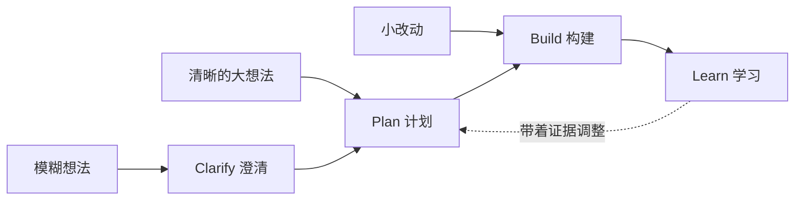

# BMAD 按规模适配交付：Clarify → Plan → Build → Learn 每个技能全解

> 日期：2026-10-07
> 主题：BMAD（Breakthrough Method of Agile AI-Driven Development）技能体系讲解——每个技能的功能作用、使用场景、主要解决的问题。

## 一、什么是 BMAD，什么是「按规模适配交付」

BMAD（Breakthrough Method of Agile AI-Driven Development）是一套「规格驱动 + 多角色 agent」的 AI 交付框架。它把软件交付全过程拆成一条循环：

**Clarify（澄清）→ Plan（计划）→ Build（构建）→ Learn（学习）**

「按规模适配」的意思是：**想法越模糊，入口越靠前；改动越小，入口越靠后**，不强迫每个变更都走全套仪式。Learn 不是终点——验证后带着证据回到 Plan 调整，循环持续修正。

它要解决的核心问题是：直接让 AI 写代码（vibe coding）缺少规划、上下文和证据链。BMAD 把「思考」固化成可追溯的工件（brief → PRD → 架构 → 票据 → 代码 + 证据），每个环节都可验收。

### 交付循环

### 按规模选入口

| 你手上有什么 | 入口 | 路径 | 典型规模 |
|---|---|---|---|
| 只有一个模糊想法 | Clarify | Clarify → Plan → Build → Learn | 0→1 新产品、新业务 |
| 清晰的大想法（知道要做什么） | Plan | Plan → Build → Learn，循环回 Plan | 成熟产品、大型新功能 |
| 小改动、需求调整 | Build | Build → Learn，直接回 Plan | 已有系统的迭代 |

## 二、五个角色 Agent 与两种调用方式

| 角色 | Skill ID | 菜单码 | 职责 |
|---|---|---|---|
| Analyst 分析师 Mary | `bmad-agent-analyst` | BP MR DR TR TS CR UV CB WB PC | 头脑风暴、市场/领域/技术调研、技术选型、竞品拆解、用户之声、产品简报、PRFAQ 挑战、项目上下文 |
| PM 产品经理 John | `bmad-agent-pm` | PRD CC TK | PRD 创建/更新/验证、纠偏、票据管理 |
| Architect 架构师 Winston | `bmad-agent-architect` | CA TK | 架构主轴（关键决策记录）、规划工作与依赖 |
| Developer 开发 Amelia | `bmad-agent-dev` | BD QA CR ER TK | 实现、e2e 测试生成、代码评审、epic 回顾、票据跟踪 |
| UX 设计师 Sally | `bmad-agent-ux-designer` | CU | UX 设计，产出 DESIGN.md 与 EXPERIENCE.md |

> 注：Technical Writer（Paige）目前休耕；项目上下文由 Analyst 的 `PC` 码或 `bmad-project-context` 承担。

BMAD 里的「技能（skill）」是一个命名命令：输入它，就加载一个 agent 角色、执行一条多步工作流、或完成一个单一任务。调用方式有两种：

- **Skill**：直接输入技能名（如 `bmad-prd`），适合明确知道要跑哪个流程时；
- **菜单码（Agent Menu Trigger）**：先加载 agent，再输两字母短码（如 `BD`），在角色内切换任务、不离开对话。

各阶段产出的工件（brief、PRD、spec、架构、tickets、代码与证据）都落盘到 initiative 文件夹，可被后续技能和 `bmad` 中枢读取。

## 三、23 个技能逐个讲（按循环阶段分组）

### ① Clarify 澄清：把模糊想法变成被验证、值得做的目标

| 技能                   | 功能作用                                       | 使用场景            | 解决的问题           |
| -------------------- | ------------------------------------------ | --------------- | --------------- |
| `bmad-brainstorming` | 引导式头脑风暴，产出 100+ 条想法与 `brainstorm.html`     | 方向模糊、需要量的积累     | 锚定第一个想法、想法太少太保守 |
| `bmad-forge-idea`    | 多角色追问压力测试半成品想法，产出 `forge-report.html`      | 有初步想法但不确定是否成立   | 想法的隐藏致命弱点，追问才暴露 |
| `bmad-deep-recon`    | 深调研：市场、领域、技术、竞品、用户之声、学术，产出带引用的 research 文档 | 任何需要证据支撑的决策     | 拍脑袋决策、缺引用与证据    |
| `bmad-product-brief` | 创建、更新或验证产品简报                               | 调研后定稿做什么、为谁、为什么 | 目标各人理解不一、从未写清   |
| `bmad-prfaq`         | Working Backwards PRFAQ 压力测试（先写新闻稿和 FAQ）   | 投入开发前验证产品叙事     | 产品故事在用户面前站不住脚   |

### ② Plan 计划：把清晰想法变成可拆解、可跟踪的落地计划

| 技能 | 功能作用 | 使用场景 | 解决的问题 |
|---|---|---|---|
| `bmad-prd` | 创建、更新或验证 PRD | 大项目的标准入口 | 需求散落聊天里、无单一事实源 |
| `bmad-spec` | 把输入压缩成短 spec | 小到不值得写完整 PRD 的变更 | 小改动过度工程化，轻量 spec 足够 |
| `bmad-ux` | UX 愿景落成 `DESIGN.md` 与 `EXPERIENCE.md` | 有界面的产品 | 代码正确但体验差、设计没提前定死 |
| `bmad-architecture` | 记录架构主轴：保持各部分一致的关键决策 | 多人或多模块并行开发 | 各自实现后拼不上、接口漂移 |
| `bmad-ticket` | 规划与跟踪 initiative、epic、ticket | 把 PRD 拆成可跟踪工作项 | 大需求拆不开、进度不可见 |
| `bmad-correct-course` | 评估中途重大变更并产出变更提案 | 做到一半需求变了 | 范围蔓延、变更吃掉原计划 |

### ③ Build 构建：把工作项变成经评审、验证、有测试守护的可信代码

| 技能 | 功能作用 | 使用场景 | 解决的问题 |
|---|---|---|---|
| `bmad-build` | 把工作项变成可运行代码，含评审与验证 | 每个 ticket 的主构建路径 | 直接让 AI 写代码、结果不可信 |
| `bmad-build-auto` | 运行一轮无人值守开发循环 | 想让 AI 自主迭代、不用人盯 | 构建过程需要人一直陪着 |
| `bmad-code-review` | 多个独立评审者评审，发现项分诊 | 变更合并前 | 单一评审者盲区、发现项堆着不分诊 |
| `bmad-walkthrough` | 逐块引导人评审 commit、PR 或文件 | 想搞懂代码到底改了什么 | diff 太大读不完、人审太慢 |
| `bmad-qa-generate-e2e-tests` | 生成 API 与端到端自动化测试 | 功能已实现、需要回归护栏 | 没有测试、重构没安全网 |

### ④ Learn 学习：基于证据验收，把教训带回下一轮计划

| 技能 | 功能作用 | 使用场景 | 解决的问题 |
|---|---|---|---|
| `bmad-retrospective` | 对照证据回顾已完成的 epic，决定接受与否 | epic 完成时 | 看起来完成 ≠ 完成，需要证据化验收 |
| `bmad-review` | 多镜头评审：对抗性、边界、验证缺口、结构、行文 | 文档定稿前、代码合并前 | 评审停留在表面、系统性盲区漏网 |

### ⑤ 通用工具：任何阶段可用的支撑技能

| 技能 | 功能作用 | 使用场景 | 解决的问题 |
|---|---|---|---|
| `bmad` | 中枢：答疑、按优先级给下一步、setup/status/migrate、管理 initiative | 任何时候卡住或不知当前状态 | 不知道下一步该干什么 |
| `bmad-advanced-elicitation` | 选命名推理法（事前验尸、第一性原理、红队、反转等）重审最新输出 | 输出看起来对但怀疑不够深 | 「再试一次」无效，需要方法逼出新角度 |
| `bmad-party-mode` | 多个 agent 或人格同场辩论，由你主持 | 大决策、想要多角度对撞 | 单视角盲区 |
| `bmad-customize` | 自然语言改技能或 agent 行为，写入 `_bmad/custom/` | 想按团队规范定制流程 | 手写 TOML 太繁琐 |
| `bmad-project-context` | 建立、刷新或审计仓库的 agent 指令 | 接手已有代码库 | AI 不懂项目约定、上下文反复丢失 |

## 四、一分钟快速选型

- 只有模糊想法 → `bmad-brainstorming` 或 `bmad-forge-idea`
- 想验证值不值得做 → `bmad-deep-recon` + `bmad-product-brief`
- 清晰的大项目 → `bmad-prd` → `bmad-architecture` → `bmad-ticket`
- 小改动 → `bmad-spec`（或直接 `bmad-build`）
- 已有代码库 → 先跑 `bmad-project-context`
- 任何时候卡住 → 直接打 `bmad`

## 五、备注

- 旧技能名（`bmad-create-prd`、`bmad-edit-prd`、`bmad-market-research`、`bmad-generate-project-context`、`bmad-checkpoint-preview` 等）仍可解析，但只作转发器，新工作一律用当前名字。
- 完整测试架构（Test Architect / TEA）、Game Dev Studio、Creative Intelligence Suite 是独立模块，按需另装。
- 每个技能的输入/输出细节见官方文档对应章节页。

## 参考资料

- [Skills and Agents — BMad Method 官方参考页](https://docs.bmad-method.org/reference/skills-and-agents/)
- [bmad-code-org/BMAD-METHOD — GitHub 仓库](https://github.com/bmad-code-org/BMAD-METHOD)
