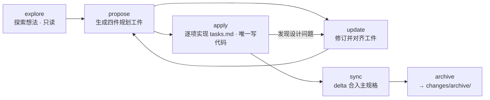
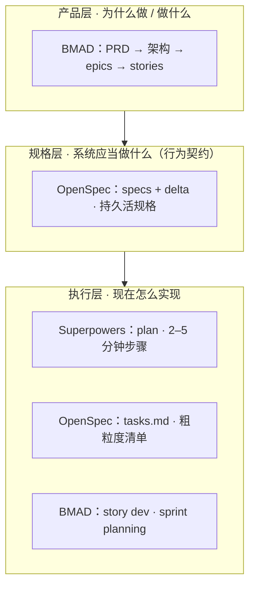

# OpenSpec 规格生命周期与 BMAD / Superpowers 对比分析

> 日期：2026-10-07
> 主题：OpenSpec change 驱动的规格生命周期（6 个技能逐一解析），以及与 BMAD Method、Superpowers 两套 AI 编码框架的层级对比。

## 一、引言

用 AI agent 写代码，最常见的失败模式是「上来就改代码」：没有可评审的计划、没有行为契约、实现过程不可控、做完之后系统「应当做什么」无人说得清。围绕这个问题，社区演化出了几套不同的方法论。本文分两部分：

1. 拆解 **OpenSpec** 的 6 个工作流技能——各自的功能、适用场景、解决的核心问题；
2. 回答一个自然的问题：*OpenSpec 是不是只盯着小任务，而 BMAD 的 plan 和 Superpowers 的 plan 才是产品级大功能设计？* 结论是：**方向对一半，两处判断需要修正。**

## 二、OpenSpec：change 驱动的规格生命周期

### 2.1 核心模型

OpenSpec 的一句话模型：**每个功能或修复都是一个「change（变更）」**。一个变更携带：

- **四件规划工件**：`proposal.md`（做什么 & 为什么）、`specs/<capability>/spec.md`（行为增量 delta，SHALL / WHEN-THEN 格式）、`design.md`（怎么做）、`tasks.md`（实现步骤清单）；
- **实现进度**：`tasks.md` 里的勾选状态（`- [ ]` → `- [x]`）；
- **规格增量**：delta specs 最终通过 sync 合入主规格 `openspec/specs/`，后者是「系统当前状态」的持久契约。

所有工作流建立在 `openspec` CLI（v1.8.0+）之上：`openspec new change` 脚手架变更、`openspec status --json` 查询工件依赖状态、`openspec instructions <artifact>` 获取每个工件的模板与规则、`openspec validate --specs` 校验规格。

### 2.2 生命周期总览



### 2.3 六个技能逐一解析

| 技能 | 生命周期阶段 | 功能作用 | 典型场景 | 主要解决什么问题 |
|---|---|---|---|---|
| `explore`（`/openspec-explore`） | ① 探索思考 | 只读的思考伙伴：读代码库、问澄清性问题、挑战假设、比较选项、画图；可按要求创建 OpenSpec 工件，但绝不写应用代码 | 模糊想法；变更前提前调研现有架构；实现中卡住想找人讨论 | 想法没想清就动代码导致返工——把「半个想法」变成「清晰的问题定义 + 方向」 |
| `propose`（`/openspec-propose`） | ② 规划·立项 | 用 CLI 脚手架创建变更，一步生成四件规划工件；只规划，绝不碰项目代码 | 方向明确后想正式立项、产出可评审的变更；评审通过前不让 AI 动手写码 | AI 编码容易「上来就改代码」且无评审留痕——强制先规划后实现，工件可评审、可修改 |
| `update`（`/openspec-update`） | ② 规划·修订 | 修订变更的既有工件并保持它们双向一致；只改已存在文件，不建新工件，不改代码；每处修改先与用户确认 | 计划写完出现新决策（「设计改用 X」）；实现中发现设计问题；想对工件做一致性审查 | 计划与现状脱节比没有计划更危险——让「单一事实源」始终最新，避免代码与计划背离 |
| `apply`（`/openspec-apply`） | ③ 实现 | 唯一写代码的技能：先读全部上下文工件，按 tasks.md 逐项做代码改动，完成一项勾一项；遇歧义、遇设计问题会暂停并给选项 | 工件齐备且评审通过后开始实现；实现可中断、可续做（重复调用继续剩余任务） | 大改动的 vibe 式实现不可控、难验收——把实现变成可见的清单（N/M 进度），每次改动限定在任务范围内 |
| `sync`（`/openspec-sync`） | ④ 规格同步 | agent 驱动的智能合并：把变更的 delta specs（ADDED / MODIFIED / REMOVED / RENAMED）合入主规格，是合并而非覆盖；支持退役 capability；完成后 `openspec validate --specs` 验证；不归档变更 | 想让主规格随功能落地即时刷新；只想同步部分 capability；希望主规格始终反映系统「现状」 | 主规格腐化：新需求不同步，后续变更就会基于过时信息做规划——让主规格保持活着的系统契约 |
| `archive`（`/openspec-archive`） | ⑤ 归档·终结 | 检查工件与任务完成度；存在 delta specs 时先提示同步（内联执行 sync 工作流并复核主规格确实已更新），然后把变更目录移入 `changes/archive/YYYY-MM-DD-变更名/` | 变更已完整实现并验证，正式收尾；迭代结束清理 changes 目录 | 完成变更堆积导致 list 杂乱混淆——给变更一个带日期时间线的正式终点，且保证归档前主规格已更新 |

**三条边界规则**：

1. `explore` / `propose` / `update` 永远不碰项目代码，只创建和修订规划工件；`apply` 是唯一写代码的技能。
2. `sync` 是「合并而非覆盖」：只应用 delta 里点名的四类操作，主规格中 delta 未提及的内容原样保留。
3. `archive` 是终点：验证主规格同步通过后才移动变更目录，防止「归档了但规格没更新」。

### 2.4 一次完整变更的典型路径

以「给系统加用户认证」为例：

1. `/openspec-explore` — 先把想法聊透：读现有 auth 相关代码、比较 JWT vs session、画数据流图；
2. `/openspec-propose add-user-auth` — 把共识固化成四件套，交给（人或 agent）评审；
3. `/openspec-apply add-user-auth` — 按 tasks.md 逐项实现；中途发现设计漏洞时，用 `/openspec-update add-user-auth` 先修计划再回来继续；
4. 全部任务勾选后 `/openspec-archive add-user-auth` — 它会自动提示把 delta spec 同步进主规格，确认后再归档。

补充：`sync` 与 `archive` 的区别在于——sync 只更新主规格、不归档，变更保持活动状态，适合「主规格必须时刻反映现状」的团队；archive 是终结操作，归档前会强制走一次同步评估。所以多数场景走到 archive 就够了，sync 是提前量。`explore` 则是「姿态」而非流程：没有强制产出，随时可以滑向「帮我开个变更」，也可以在实现中卡住时回来当思考伙伴。

## 三、OpenSpec vs Superpowers vs BMAD

### 3.1 问题与初步判断

一个自然的直觉是：OpenSpec 解决的是具体功能或 bug 修复，着眼于小任务；而 BMAD 的 plan 和 Superpowers 的 plan 是产品级大功能的设计与计划。

**这个判断对一半，两处需要修正：**

- ✅ **对**：BMAD 的 plan 确实是产品级——PRD 是中心必需工件，由 PM / Architect / PO 等人格化 agent 做需求、架构、epic 拆分，工作流强制经过 Create PRD → Create Architecture → Create Epics & Stories → Check Implementation Readiness → Sprint Planning → Create Story → Dev Story，步骤不可跳过。
- ⚠️ **修正 1**：OpenSpec 不限于小任务。它的单元是 change（一次行为增量），可以是 bug、也可以是跨模块大功能，唯一约束是「一个连贯的决策单元」；它真正的边界是**不做产品发现**（为什么做、给谁做、市场价值）。
- ⚠️ **修正 2**：Superpowers 的 plan 不是产品级。它是单功能的详细可执行实现计划，`writing-plans` 会拆到 **2–5 分钟一步**（含代码与测试），粒度其实是三者里最细的。

### 3.2 三框架对比

| 维度 | OpenSpec | Superpowers（obra） | BMAD Method |
|---|---|---|---|
| 定位 | change 驱动的规格生命周期（specs 即事实源） | 工程过程纪律 + 详细执行计划 | 产品到代码的全链路多 agent 敏捷流 |
| 核心工件 | proposal / delta spec（SHALL·WHEN-THEN）/ design / tasks 四件套 | brainstorming 设计 + plan 文件（细到 2–5 分钟步骤，含代码与测试） | PRD、架构、epics、stories、sprint 状态 |
| 工件性质 | 持久：每次变更 sync 进主规格，archive 留带日期的时间线 | 一次性：执行中消耗，用完即弃 | 项目文档：保留，但不是活着的系统规格 |
| 粒度与规模 | change = 一次行为增量：bug 到跨模块大功能皆可，须为连贯决策单元 | 单仓库单功能；plan 拆成三者中最细的步骤 | 产品 → epic → story；story 是开发单元 |
| 做产品发现吗 | 不做 | 有限：brainstorming 是工程需求澄清，非市场/用户研究 | 做：PM/PO 人格、PRD、验收标准 |
| 维护活系统规格 | 是——三者中唯一 | 否 | 否（架构是一次性文档） |
| 实现指导方式 | tasks.md 粗粒度清单，agent 有实现自由度 | 极细步骤指令 + TDD + 检查点 + subagent 执行 | story + dev agent，sprint 计划检查实现就绪度 |
| 核心价值 | 规格治理：行为始终有契约，可审计、可追溯 | 过程纪律：TDD、验证、检查点，压制 AI 漂移 | 角色分工：多 persona 模拟敏捷团队，适合大项目 |

### 3.3 真正的区分轴：三层模型

三者不在同一个维度上竞争「大与小」，而是管理系统的不同层：



三者的「聪明」落在不同地方：

- **OpenSpec 的聪明在规格本身**：SHALL/WHEN-THEN 行为契约是单一事实源，代码必须服从规格，且规格随每次变更持续同步、永不腐化。它管的是「系统应当做什么」这一层——感觉它「着眼于具体功能」，是因为输出天然是行为级的，但它并不限制 change 的规模上限。
- **Superpowers 的聪明在过程纪律**：`brainstorming`（苏格拉底式澄清）→ `writing-plans`（拆到 2–5 分钟一步、带代码和测试）→ `executing-plans`（分批执行、检查点确认）+ TDD + subagent 执行。plan 是「怎么把这一个功能可靠地做出来」的执行剧本，做完即弃——不维护系统级规格，也不关心产品战略。
- **BMAD 的聪明在角色分工**：PM、Architect、PO、Dev、QA 多 persona 协作，PRD 为中心工件，epic → story 分解，sprint 计划做实现就绪检查。它是唯一从「为什么做」开始的那一个。

一句话版本：

| 框架 | 回答的问题 |
|---|---|
| BMAD | **做什么产品、怎么分解**（产品 → epic → story） |
| OpenSpec | **系统应当做什么、怎么合法地改它**（行为契约 + 变更治理） |
| Superpowers | **眼前这个功能怎么一步步做出来不翻车**（执行剧本 + 过程纪律） |

### 3.4 组合建议：互补而非竞争

1. **0→1 新产品**：BMAD 出 PRD + 架构 + epics → 每个 epic/story 落地时，需要持久行为契约的用 OpenSpec change 实现，需要细颗粒执行计划 + TDD 纪律的用 Superpowers。
2. **成熟系统、规格治理优先**（合规、多团队、长生命周期）：以 OpenSpec 为中心，迭代增量全部走 change，不必引入另外两套。
3. **单功能快速迭代**（内部工具、脚本、side project）：只用 Superpowers 的 brainstorm → plan → execute，最轻；此时 OpenSpec 的规格开销是净成本。

一个细节：OpenSpec 之所以「感觉小」，是因为它强制 change 保持连贯（一个决策单元、一次可评审的 delta），大工作会被拆成多个 change——这个哲学与 BMAD 的 epic→story 分解同构，只是 OpenSpec 没有内建的「epic / 产品」上层结构。需要产品级分解时，要自己补文档，或引入 BMAD。

## 四、让 OpenSpec 支持严格 TDD（可选机制）

### 4.1 先修正一个心智模型

openspec-apply 技能本身**没有内置**「单元测试 + E2E」步骤——apply 期间观察到的测试工作，来自 tasks.md 里的任务项（propose 按项目规则生成）+ agent 逐项执行。因此「让 apply 支持严格 TDD」的正确做法不是给 apply 加开关，而是：

1. 把 TDD 写进**任务清单**（propose 侧）——TDD 步骤变成可勾选的任务；
2. 把 TDD 写进**执行契约**（apply 侧）——每次 apply 会话都遵守；
3. 可选加 **CI 硬闸门**（OpenSpec 之外）——唯一真正的「强制」手段。

### 4.2 四层机制（从软到硬）

| 层级 | 机制 | 作用点 | 约束力 |
|---|---|---|---|
| 1 · 软 | `openspec/config.yaml` 的 context 写 TDD 协议 | 所有 apply 会话（prompt 级必需输入，每次 apply 开头必读） | prompt 级：agent 应遵循，但 CLI 不验证是否真跑了测试 |
| 2 · 结构 | `rules.tasks` 写 TDD 拆分规则 | propose 生成的 tasks.md | 结构性：每个功能必须拆成红-绿-重构步骤，进度可见 |
| 3 · 原生可选 | 自定义 schema（如 spec-driven-tdd）：TDD 指令与模板写进 schema | 按 change 开启：`openspec new change <name> --schema spec-driven-tdd` | OpenSpec 原生最强大：默认 schema 保持轻量，按变更开 TDD |
| 4 · 硬闸门 | CI / pre-commit / 分支保护 | OpenSpec 之外 | 唯一真正的严格：测试不过不让合并 |

**为什么 TDD 与 apply 天然契合（不需要任何额外机制）**：

- apply 逐项执行、逐项勾选 → 红/绿/重构阶段直接体现在 N/M 进度里，随时可见当前处在 TDD 哪个阶段；
- apply 的护栏本来就有「遇错、遇阻、需求不清时暂停——不猜」→ 红阶段测试意外通过正好触发暂停条件，等于 TDD 的 red checkpoint 白送；
- DSH 环境里 apply 是真的跑 shell 命令（pwsh / npm test），红绿证据是真实命令输出，不是 agent 的自我声明。

### 4.3 方法一：config.yaml always-on（第 1+2 层，推荐起点）

**适用**：希望项目内所有变更统一要求 TDD 的团队。

**操作步骤**：

1. **确认项目已有 OpenSpec 根**：项目根运行 `openspec list`；若没有 `openspec/` 目录，先运行 `openspec init` 创建（含 config.yaml）。
2. **编写 `openspec/config.yaml`**（新增或合并，保留已有内容）：

```yaml
# openspec/config.yaml（TDD-ready，按你的技术栈调整）

context: |
  技术栈: Node.js 24 + TypeScript + Vitest + Playwright
  测试纪律（apply 阶段必须遵守）:
  - 严格 TDD: 每个新行为先写失败测试并确认其失败（红），
    再写最小实现使其通过（绿），最后才重构
  - 单元测试覆盖所有新行为；跨模块变更必须有 Playwright E2E
  - 对应测试未实际运行并通过，任务视为未完成
  - 红阶段测试若意外通过，必须暂停排查原因，不得直接勾选

rules:
  tasks: |
    tasks.md 必须按 TDD 循环拆分，每个功能项依次包含:
    1. 写失败测试并确认失败（红）
    2. 最小实现使测试通过（绿）
    3. 重构（保持测试绿）
    末尾固定两条验收:
    - 全部单元测试通过（npm test）
    - E2E 全部通过（npm run e2e）
```

说明：`context` 是每次 apply 的必需 prompt 级输入（实现时作为约束应用）；`rules.tasks` 仅在 propose 生成 tasks.md 时生效，把 TDD 拆分结构固定在任务层。生效后 tasks.md 形如：

```markdown
## 1. 登录校验
- [ ] 1.1 写失败单测: 密码为空时抛 INVALID_CREDENTIALS（确认失败，红）
- [ ] 1.2 最小实现登录校验器（测试通过，绿）
- [ ] 1.3 抽取校验规则复用（重构，测试保持绿）

## 2. E2E 拉通
- [ ] 2.1 Playwright 流程: 注册 → 登录 → 访问受保护页（红）
- [ ] 2.2 完成路由守卫使流程通过（绿）

## 3. 验收
- [ ] 3.1 npm test 全部通过
- [ ] 3.2 npm run e2e 全部通过
```

3. **验证规则生效**：对任一变更运行 `openspec instructions tasks --change <name> --json`，确认返回的 `rules` 包含 TDD 规则；propose 完成后打开 tasks.md 确认已按红/绿/重构 + 验收项拆分。
4. **照常使用**：`/openspec-propose` → 评审 → `/openspec-apply`，apply 开头读 context 中的 TDD 纪律，逐项执行。
5. **（可选，推荐）加第 4 层硬闸门**，让「测试不过 = 不能提交/合并」成为最终兜底。示例（GitHub Actions，PR 触发）：

```yaml
# .github/workflows/ci.yml（示例）
name: ci
on:
  pull_request:
jobs:
  test:
    runs-on: ubuntu-latest
    steps:
      - uses: actions/checkout@v4
      - uses: actions/setup-node@v4
        with:
          node-version: 24
      - run: npm ci
      - run: npm test
      - run: npm run e2e
```

本地则可用 husky + pre-commit 在 `git commit` 前跑 `npm test`。

### 4.4 方法二：spec-driven-tdd 自定义 schema（第 3 层，按 change 可选）

**适用**：默认不想被 TDD 约束，但希望某个变更单独「开启严格 TDD」的团队。

**操作步骤**：

1. **列出现有 schema**：`openspec schemas --json`（确认内置 spec-driven 与已发现的自定义 schema）。
2. **创建自定义 schema**：项目根 `openspec/schemas/spec-driven-tdd/` 目录，写入 `schema.yaml`。
3. **schema.yaml 参考骨架**：以内置 spec-driven schema 为模板复制，仅把 tasks 工件的 `instruction` 换成 TDD 版，四工件与 applyRequires 保持不变：

```yaml
# openspec/schemas/spec-driven-tdd/schema.yaml（参考骨架）
# 字段名以本机 `openspec schemas --json` 的输出为准，以内置 spec-driven schema 为模板
name: spec-driven-tdd
description: spec-driven + 严格 TDD（红-绿-重构）
artifacts:
  - id: proposal
    generates: proposal.md
    instruction: （同内置 spec-driven：做什么与为什么）
  - id: specs
    generates: "specs/**/*.md"
    instruction: （同内置：delta spec，SHALL / WHEN-THEN）
  - id: design
    generates: design.md
    instruction: （同内置：怎么做；建议追加「设计须说明每个需求如何被测试验证」）
  - id: tasks
    generates: tasks.md
    instruction: |
      tasks.md 必须按 TDD 循环拆分，每个功能项依次包含:
      1. 写失败测试并确认失败（红）
      2. 最小实现使测试通过（绿）
      3. 重构（保持测试绿）
      末尾固定两条验收:
      - 全部单元测试通过
      - E2E 全部通过
applyRequires:
  - tasks
```

与方法一的区别：方法一的 rules 作用于「默认 schema 的 tasks」，always-on；方法二的 instruction 写在 schema 自身，只对显式选择 spec-driven-tdd 的变更生效。两者可叠加（第 1 层 context 的 TDD 纪律始终生效，schema 只负责任务结构）。

4. **验证 schema 被发现**：`openspec schemas --json` 输出中应出现 spec-driven-tdd。
5. **按变更开启**：`openspec new change add-user-auth --schema spec-driven-tdd`，之后照常走 propose / apply 流程；默认变更不加 `--schema`，继续走轻量 spec-driven。
6. **验证指令**：`openspec instructions tasks --change add-user-auth --json` 返回 TDD 版 instruction。

### 4.5 诚实的边界

- 第 1–3 层都是 prompt/结构级约束：OpenSpec CLI 只管工件存在性与状态，`openspec validate` 校验的是规格格式，它不跑任何测试——agent 理论上可以「声称」绿了。
- 真正的严格 = 第 4 层硬闸门（CI / pre-commit / 分支保护）。**四层叠加才是真严格**，单靠 OpenSpec 没有「强制」二字。
- 折中做法：在任务描述里要求「附 `npm test` 真实输出确认」，评审时核对；DSH 环境里 apply 实际执行命令，可以拿到真实输出。

### 4.6 Token 经济学（对比 Superpowers）

Superpowers 收的税：brainstorming 苏格拉底往返 + 2–5 分钟极细 plan + executing-plans 检查点 + subagent 各自独立上下文 + TDD skill 开销。TDD 化的 OpenSpec：单上下文、粗粒度但结构化为 TDD 的任务清单、无人格无 subagent。纪律保住了，税砍掉了——TDD 拆分会让任务数变多，但每步更小、自验证、返工更少，总体比「先写代码后补测试」便宜，也远便宜于 Superpowers。

## 五、参考

- Superpowers（obra/superpowers，agentic skills framework）：https://github.com/obra/superpowers
- Superpowers 核心技能详解（writing-plans / executing-plans）：https://datawhalechina.github.io/easy-vibe/en/stage-3/core-skills/superpowers/
- BMAD Standard Workflow（PRD → Architecture → Epics & Stories → Sprint → Dev）：https://dev.to/jacktt/bmad-standard-workflow-2kma
- Spec-Driven Development with the BMAD Method：https://sam-solutions.com/blog/spec-driven-development-with-bmad-method/
- OpenSpec 技能组（explore / propose / update / apply / sync / archive）：本地 DSH skills，基于 openspec CLI v1.8.0+
- OpenSpec CLI（v1.8.0+）：本机全局安装，命令详情见 `openspec --help`（`init` / `new change` / `status` / `instructions` / `schemas` / `validate` / `archive`）
