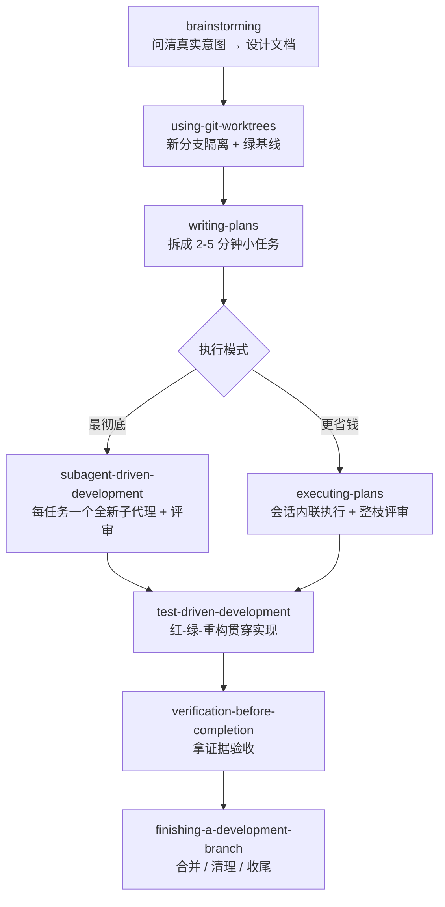
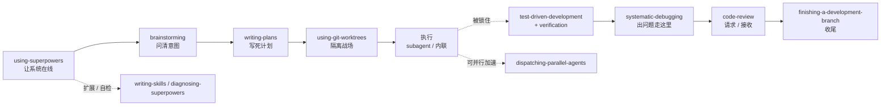

# Superpowers 技能体系详解：自动触发 + 工程纪律

> 日期：2026-10-07
> 主题：AI Coding · Agent 技能框架
> 来源：[obra/superpowers](https://github.com/obra/superpowers)（当前 v6.4.2）
> 关键词：技能自动触发 · TDD · 子代理驱动开发 · 系统化调试 · 强制工作流

---

## 一、Superpowers 是什么

Superpowers 是 obra（Jesse Vincent）开源的一套「**软件开发方法论 + 可组合技能库**」，专为编码 agent 设计。它的核心机制不是让你手动敲 `/命令`，而是：

> **会话一开始就生效，靠技能自身的 description 元数据自动匹配触发。**
> agent 一察觉你在「构建 / 改 bug / 评审」，对应的技能就自己加载，把流程**强制**走一遍，而不是给出建议。

一句话概括它的定位：**不是固定阶段，而是一组会话开始即生效、自动触发的技能；是强制性工作流，而非建议。**

### 1.1 三条哲学

| 哲学 | 含义 |
|---|---|
| **TDD** | 先写失败测试，再写代码（真·红绿重构），YAGNI、DRY |
| **Process over ad-hoc** | 用强制流程，而非临时发挥 |
| **Evidence over claims** | 拿证据证明做完了，而不是口头声称「应该能跑了」 |

### 1.2 自动触发是怎么做到的

1. **引导注入（using-superpowers）**：会话启动时（以及上下文被压缩 compaction 之后）自动注入「如何使用 Superpowers」的说明，教会 agent 在动手前先查「有没有技能适合当前任务」。
2. **描述匹配**：每个技能自带触发描述（description），harness 根据对话内容自动匹配并加载对应技能。
3. **结果**：你不需要做任何特殊操作，agent 就「自带 Superpowers」。官方验证方式：新会话里发一句 `Let's make a react todo list`，安装正确的话 `brainstorming` 会在写任何代码前自动触发。

---

## 二、主工作流（Happy Path）

从「你开始构建」到「分支收尾」的主链路如下（每一步都自动衔接）：



另有若干**按需 / 元技能**，不在主链路上，而是满足条件时才触发（见下文第 ⑦⑧⑩ 组）。

---

## 三、15 个技能逐个详解

> 每个技能按 **功能作用 / 触发场景 / 解决的问题** 三维度讲解。

### ① 元·引导层

#### using-superpowers（元技能 / 引导）
- **功能作用**：整套框架的入口。会话启动时（以及上下文被压缩 compaction 之后）自动注入「如何使用 Superpowers」的引导说明，教会 agent 在动手前先查「有没有技能适合当前任务」。
- **触发场景**：每个会话开始自动注入；压缩后再次注入。无需手动触发。
- **解决的问题**：技能只是躺在目录里的文件，没有引导 agent 根本不知道要去读。它解决「技能为什么没触发」和「长会话压缩后忘了用」的问题，保证整套技能**始终在线**。这就是「会话开始即生效」的真正来源。

### ② 发现层

#### brainstorming（需求挖掘）
- **功能作用**：在写任何代码**之前**激活。agent 不直接开建，而是先反问「你到底想做什么」，探索多种方案，把设计**分节**给你确认，最后落盘成一份设计文档。
- **触发场景**：agent 一察觉你「要构建某样东西」就自动触发——这正是「一看到你开始构建，就先追问你真正想做什么」。
- **解决的问题**：模糊想法被直接开写 → 做错了方向、白干返工。强制「先对齐意图与设计，再动手」，从源头砍掉无效工作。

### ③ 规划层

#### writing-plans（写实现计划）
- **功能作用**：设计获批后，把工作拆成 **2–5 分钟**一个的小任务；每个任务都写清**精确文件路径、完整代码、验证步骤**——精细到「一个热情但没判断力、没项目上下文、不爱写测试的初级工程师」都能照着做。
- **触发场景**：设计文档被批准后自动激活。
- **解决的问题**：计划太粗、被 agent 自由发挥 → 执行跑偏、偷工减料。强制「计划可执行 + 信息完整」，这是它能**自主连续跑几小时不跑偏**的前提。

### ④ 隔离层

#### using-git-worktrees（Git 工作树隔离）
- **功能作用**：设计批准后，在新分支上建一个**独立工作区**，跑项目初始化，并确认**测试基线是绿的**（动手前基线必须干净）。
- **触发场景**：设计批准之后、正式执行之前自动激活。
- **解决的问题**：直接在主分支上改 → 污染基线、难回滚、难验证对错。强制「独立分支 + 先确认绿基线」，让工作可回滚、改动可对照。

### ⑤ 执行层

#### subagent-driven-development（子代理驱动开发 · 最彻底）
- **功能作用**：对每个工程任务**派一个全新子代理**去实现，做完后**评审**其产出，通过再进入下一个。每个任务都用干净上下文，不累积污染。
- **触发场景**：计划完成后自动激活，是默认的推荐执行模式。
- **解决的问题**：单个 agent 长时间连做 → 上下文污染、判断退化、错误滚雪球。「一任务一新代理 + 独立评审」让长自主运行保持高质量，agent 常常能自主连续工作数小时而不偏离计划。

#### executing-plans（执行计划 · 省钱版）
- **功能作用**：轻量执行模式——不在每个任务开子代理，而是在**当前会话内联**逐任务实现，最后对**整个分支做一次**全新评审。
- **触发场景**：当任务较小、风险较低、你想要更快更省时地执行时自动激活（与上一个二选一）。
- **解决的问题**：子代理模式成本高（一任务一代理）。提供一个「够用、更省」的替代，按任务规模 / 风险匹配执行力度。

#### dispatching-parallel-agents（并行派发代理）
- **功能作用**：把多个**相互独立**的任务同时派给多个子代理并行处理。
- **触发场景**：出现一批可并行、互不冲突的工作时触发。
- **解决的问题**：串行执行太慢。用并行压缩墙钟时间。关键前提：任务必须真正独立，否则会互相冲突。

### ⑥ 纪律层（哲学的落地）

#### test-driven-development（TDD）
- **功能作用**：强制 **红-绿-重构**：先写一个**会失败的测试** → 看它失败 → 写**最小**代码 → 看它通过 → 提交。强调真·红绿、YAGNI、DRY，甚至会删掉「没先写测试就写的代码」。
- **触发场景**：实现阶段自动激活。
- **解决的问题**：agent「先写码、后补测试」→ 测试沦为摆设、覆盖率虚高。强制「测试先行」，让每行代码都有对应测试，正确性和重构信心都有保障。

#### verification-before-completion（完成前验证）
- **功能作用**：在宣称「做完了」**之前**，先收集**证据**证明它确实可用——跑测试、跑程序、检查真实输出，而不是凭感觉。
- **触发场景**：任何「完成 / 成功」的声明之前，自动触发。
- **解决的问题**：agent 说「应该能跑了」但没验证 → 带着 bug 报喜。落地「**evidence over claims**」——证据不摆出来就不算完成。

### ⑦ 调试层

#### systematic-debugging（系统化调试）
- **功能作用**：四阶段根因分析：**复现问题 → 收集数据 → 分析原因 → 验证修复**。核心是「先找根因，再动手修」，绝不靠猜、不靠打补丁。
- **触发场景**：一旦出现 bug、报错，或你问「为什么 X 失败了」就自动触发。
- **解决的问题**：agent 盲目试错打补丁 → 治标不治本，还引入新 bug。强制「先定位根因」，让修复一次到位。

### ⑧ 评审层

#### requesting-code-review（发起代码评审）
- **功能作用**：代码完成后**主动**发起评审，把改动、上下文、关注点整理好交给评审方。
- **触发场景**：实现完成、进入评审阶段时触发。
- **解决的问题**：代码写完就默认 OK、从没人看 → 质量 / 安全问题漏网。把「主动求评审」变成制度性动作。

#### receiving-code-review（接收代码评审）
- **功能作用**：一套**应对评审反馈的纪律**：先 **READ**（完整读完、不急着反驳）→ **UNDERSTAND**（用自己的话复述需求，有疑问就问）→ 然后再行动。
- **触发场景**：收到评审意见 / 反馈时触发。
- **解决的问题**：agent 面对反馈要么**防御性反驳**、要么**盲从全收** → 真问题被忽略，或好心办坏事。强制「先理解、再回应」。

### ⑨ 收尾层

#### finishing-a-development-branch（收尾开发分支）
- **功能作用**：开发完成后做收尾：合并分支、清理工作树、按规范处理（PR / squash 等）。
- **触发场景**：分支上所有任务完成并通过验证后触发。
- **解决的问题**：做完了但没清理 → 分支 / 工作树堆积、主分支迟迟不合并。把「收尾」闭环，不留烂尾。

### ⑩ 元·扩展层

#### writing-skills（写技能）
- **功能作用**：指导**创作新技能**：标准文件组织（`SKILL.md` + 参考文件 + 脚本）、如何写触发描述、怎么让技能既会被触发又可复用。
- **触发场景**：你想往 Superpowers 里**新增**一个技能时触发。
- **解决的问题**：技能写得不规范 → 不被触发、没法复用。提供一套「可复用技能」的写作方法论（Superpowers 自己也是用这套方法写出来的）。

#### diagnosing-superpowers（诊断框架本身）
- **功能作用**：元诊断技能。当 Superpowers **自身**表现异常——技能该触发没触发、会话启动钩子没生效、行为不符合预期时，帮你定位问题在哪一层。
- **触发场景**：你发现「技能没起来」「行为不对」时触发。
- **解决的问题**：框架自己出问题却没人知道为什么。提供一条**自我诊断**路径，让这套强制流程本身也能被排查。

---

## 四、它们如何咬合成一条流水线

这套东西的价值**不在单个技能多聪明**，而在于它们**互相咬合成一条强制流水线**——任何一步想「跳过」都会被下一个技能拦住。这正是「强制性工作流而非建议」的工程纪律所在。



| 层 | 技能 | 一句话 |
|---|---|---|
| 元·引导 | using-superpowers | 让整套技能始终在线 |
| 发现 | brainstorming | 写码前问清「你真正想做什么」 |
| 规划 | writing-plans | 拆成 2–5 分钟、信息完整的小任务 |
| 隔离 | using-git-worktrees | 新分支 + 绿基线，可回滚 |
| 执行 | subagent-driven-development / executing-plans | 一任务一新代理（彻底）或内联（省钱） |
| 执行 | dispatching-parallel-agents | 独立任务并行加速 |
| 纪律 | test-driven-development | 红-绿-重构，测试先行 |
| 纪律 | verification-before-completion | 拿证据验收，不口头声称 |
| 调试 | systematic-debugging | 先复现、找根因，再修 |
| 评审 | requesting / receiving-code-review | 主动求评审；先理解再回应 |
| 收尾 | finishing-a-development-branch | 合并、清理、闭环 |
| 元·扩展 | writing-skills / diagnosing-superpowers | 造新技能 / 自检框架 |

---

## 五、Superpowers × OpenSpec：互补搭配

Superpowers 解决了「怎么写」，但它回答不了「**写什么**」。这正是 **OpenSpec** 补上的那一半：一个管**规格（what / why）**，一个管**纪律（how）**，两者天然互补。

### 5.1 OpenSpec 一句话定位

OpenSpec（Fission-AI）是面向 AI 编码助手的 **Spec-Driven Development（SDD）** 工具，核心是：**写代码之前，先写一份可验证的规格说明。**

- **四个规划工件**（构成完整规划链）：`proposal`（提案，为什么/做什么）→ `specs`（规格，行为如何变化）→ `design`（设计，技术决策）→ `tasks`（任务拆解，实现清单）。
- **目录结构**：`openspec/specs/`（主规格 = 系统当前「事实来源」）+ `openspec/changes/<变更名>/`（每个变更一个独立文件夹，装四件套）+ `changes/archive/`（已完成的变更）。
- **六个命令**：`/openspec-propose`（生成四件套）· `/openspec-explore`（思考伙伴、只读澄清需求、绝不写码）· `/openspec-apply`（逐任务实现）· `/openspec-update`（修订已有规划工件）· `/openspec-sync`（把 delta spec 合并进主规格）· `/openspec-archive`（归档变更）。
- **关键特性**：规格**「活在代码里」**（spec-anchored），不是一次性对话产物；Delta Spec **既人类可读又机器可解析**；**无刚性阶段门禁**——任何工件随时可改，流程流动。

### 5.2 分工：各自侧重解决什么问题

| 维度 | OpenSpec | Superpowers |
|---|---|---|
| 核心问题 | **写什么、为什么写**（what / why） | **怎么写**（how） |
| 性质 | 规格 / 工件驱动 | 流程 / 技能驱动 |
| 产出物 | **持久化文件**（specs / changes） | **过程**（实时执行中的强制） |
| 面向谁 | 供**人**审阅需求与变更 | 供 **agent** 严谨执行 |
| 主要解决 | 需求漂移、范围蔓延、无规格、规格腐烂、难评审 | agent 跑偏、无测试代码、虚假完成、盲目调试 |
| 时间维度 | 长期（活的规格、可追溯记录） | 实时（构建过程中的强制） |
| 比喻 | **火车头**（制定路线图）/ 猛虎 | **铁轨**（保证列车按规范行驶）/ 双翼 |

一句话：**OpenSpec 是「脑」（决定并记录要造什么），Superpowers 是「肌肉」（带纪律地执行）。**

### 5.3 搭配的关键：补上「规划—执行断层」

把两个插件一起装上，并不等于它们会自动配合——**两者之间缺一个衔接层**。最常见的坑是：

> 代码写完了，规划文档还躺在仓库里吃灰。
> 你在规划阶段花了 30% 的精力，但这些产出物对后续 70% 的执行阶段毫无约束力——执行阶段的 AI 不知道那些约束存在，知道也不会主动去读。

所以搭配的关键是**在「规划」和「执行」之间建一座桥**：把规划压缩成一份执行阶段**真正可强制**的**执行契约**。一份设计良好的桥（契约）通常包含：

1. **意图锁（Intent Lock）**：用一句话锁定本次变更的核心意图。执行阶段任何决策都必须对齐这个意图，对不上就拒绝执行。它是给**范围蔓延**上的紧箍咒——拦住那种「顺手重构一下」最后引爆 7 个文件回归的冲动。
2. **约束清单（Constraint Checklist）**：从四个规划文档里抽出所有**硬约束**（性能指标、兼容性要求、安全规范），变成**可验证的检查项**，执行时逐条守住。
3. **验收标准（Acceptance Criteria）**：每个 task 的完成标准 = **「代码写完 且 通过这些验证」**，而不是「代码写完了」。
4. **（进阶）内容级校验**：签约时对规划文档记一份哈希（如 SHA256），执行前重算比对——防止「规划文档在签约后被悄悄改过」，一旦不一致，契约即作废、需重新签。

需要说明：上面三要素是**「好的桥应当长成的样子」（设计原则）**，并不是某个工具一条命令就能吐出文件的东西。在**原生 OpenSpec + Superpowers** 里，这三要素**本就分散**在四件套中——意图锁 ≈ `design.md` 的 Goals / Non-Goals，约束清单 ≈ `specs/` 的 SHALL / MUST 需求，验收标准 ≈ `tasks.md` 里**每个任务自带的验证步骤**（官方要求每个 task 必须写明如何验证完成）；并没有一份单独的「执行契约」文件，也没有哈希校验。只有走**整合框架（方式 C）**，才有专门的 `contract-builder` 命令把它们压缩成一份 `execution-contract.md`（见 5.4、5.5）。

此外，工作流会在若干关键节点设**决策点（DP）**：需求确认 / 提案确认 / 规格确认 / 设计确认 / 任务确认 / 契约确认 / 批次确认 / 收尾确认，强制 AI 停下来征求人确认。设计哲学是**把人的判断力用在刀刃上**，而不是让 AI 在无关紧要处反复问「要不要继续」。

### 5.4 一个完整的搭配工作流

```
[OpenSpec 主导]                     [桥接层]                  [Superpowers 主导]
/openspec-explore   澄清需求
/openspec-propose   → proposal + specs + design + tasks
                                        ↓
                原生（方式 A）：无专门命令，三要素本就分散在四件套
                      意图 = design.md 的 Goals/Non-Goals · 约束 = specs 的 SHALL/MUST
                      验收 = tasks.md 逐任务验证步骤（writing-plans 可再拆细粒度计划）
                整合框架（方式 C）：contract-builder → execution-contract.md
                      （意图锁 + 约束清单 + 验收标准 + SHA256）
                                        ↓
using-git-worktrees  新分支 + 绿基线
/openspec-apply      逐任务实现   ←  Superpowers 纪律全程在场：
                                      TDD 红-绿-重构
                                      subagent-driven-development / executing-plans
                                      verification-before-completion（拿证据验收）
                                      （遇到 bug → systematic-debugging）
                                        ↓
requesting / receiving-code-review   评审
                                        ↓
/openspec-sync       delta spec 合并进主规格
/openspec-archive    归档变更    +   finishing-a-development-branch  合并 / 清理
```

阶段级映射：

| 阶段 | OpenSpec（what） | Superpowers（how） |
|---|---|---|
| 需求澄清 | `/openspec-explore`（思考伙伴，只读） | brainstorming 纪律（问清真实意图） |
| 产出规划 | `/openspec-propose`（四件套） | writing-plans（拆成 2–5 分钟可执行子任务） |
| 隔离 | — | using-git-worktrees（新分支 + 绿基线） |
| 建契约（桥） | 三要素本就分散在四件套（design Goals/Non-Goals · specs SHALL/MUST · tasks 逐任务验证） | 原生：无专门命令（writing-plans 再拆细粒度）；整合框架：contract-builder → execution-contract.md |
| 执行 | `/openspec-apply`（逐任务、勾选） | TDD + subagent-driven-development / executing-plans + verification-before-completion |
| 调试 | — | systematic-debugging |
| 评审 | — | requesting / receiving-code-review |
| 收尾 | `/openspec-sync` + `/openspec-archive` | finishing-a-development-branch |

搭配的精髓：**OpenSpec 告诉你「做哪些任务」，Superpowers 告诉你「每个任务怎么严谨地做」。** OpenSpec 的 `tasks.md` 就是 Superpowers 的**计划输入**，OpenSpec 的 `apply` 就是 Superpowers 的**纪律化执行**，OpenSpec 的 `archive` 就是 Superpowers 的**分支收尾**。

### 5.5 社区的三种落地方式

| 方式 | 做法 | 优点 | 缺点 |
|---|---|---|---|
| A. 双插件 + 手动桥接 | 两个插件都装，规划产物由你手动搬运进执行 | 零额外依赖、最灵活 | 你成了「翻译官」，状态不对齐时易掉链子 |
| B. 外部编排 | 用 YAML 状态机（如 Comet）编排对两个工具的**外部调用** | 配置灵活、平台覆盖广 | 两个工具互不知晓对方内部状态，只能做「表面」状态检查 |
| C. 源码级融合框架 | 把两者引擎吸收进一套自洽的 skill / 状态机（如 spec-superflow） | 紧致自洽、内容级状态检测、无需手动桥接 | 要学一套全新概念（9 skill / 8 状态 / 8 DP） |

> 说明：B、C 是社区的具体项目示例，仅作路线对照；用哪种不关键。

无论走哪条路，**本质都一样**：在「规划」和「执行」之间建立一份**契约**，让执行阶段的约束**真正来自规划阶段的产出**，而不是靠人临场记性。

### 5.6 小结

- **OpenSpec** 回答「**写什么、为什么写、怎么记录下来**」（what / why + 持久规格），解决需求漂移、范围蔓延、规格腐烂。
- **Superpowers** 回答「**怎么写得稳**」（how + 执行纪律），解决 agent 跑偏、无测试、虚假完成、盲目调试。
- **两者之间的桥是「执行契约」**（意图锁 + 约束清单 + 验收标准）：把规划压缩成执行阶段可强制的形式，「规划—执行断层」被补上，从需求澄清到变更归档形成自洽闭环。

---

## 六、小结

- **定位**：给编码 agent 的完整软件开发方法论，靠**自动触发**把最佳实践变成**强制流程**。
- **核心**：TDD · Process over ad-hoc · Evidence over claims 三条哲学，由 15 个技能落地。
- **精髓**：单技能不稀奇，**互相咬合、谁也跳不过**才是工程纪律的来源——agent 能长时间自主运行而不跑偏，靠的就是这条流水线。
- **搭配**：与 OpenSpec（规格管「写什么」）配合，Superpowers（纪律管「怎么写」）——用「执行契约」补上规划与执行的断层，从需求到归档形成自洽闭环（详见第五章）。

> 参考资料：
> - [obra/superpowers（GitHub）](https://github.com/obra/superpowers)
> - [skills 目录（15 个技能）](https://github.com/obra/superpowers/tree/main/skills)
> - [Fission-AI/OpenSpec（GitHub）](https://github.com/Fission-AI/OpenSpec) · [openspec.dev](https://openspec.dev/)
> - [AI 编程工作流选型：Spec-Kit、OpenSpec、Superpowers 深度对比（腾讯云）](https://cloud.tencent.com/developer/article/2649106)
