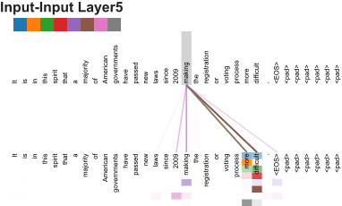
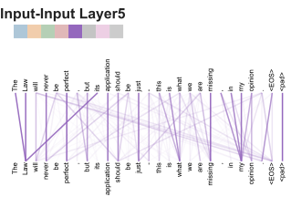
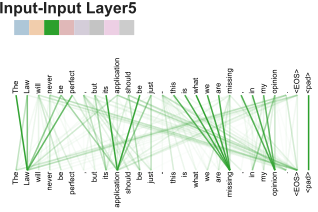

# Attention Is All You Need 论文学习

> 范围：Vaswani 等 8 人（Google Brain / Google Research），NIPS 2017，arXiv:1706.03762。本文先给出论文核心内容速览，随后附论文正文**逐段中英对照**（英文原文在前，中文翻译在后；专业术语、数学公式保留英文/公式原样），论文图片已下载到 `pictrue/` 目录并在文中引用。
>
> **关联阅读**：
> - [2026-10-02 Logits到底是什么](../SystemOne/2026-10-02%20Logits到底是什么.md)
> - [2026-09-23 Jev(System One Model)开源模型调研](../SystemOne/2026-09-23%20Jev(System%20One%20Model)开源模型调研.md)

---

## 论文核心内容速览

《Attention Is All You Need》（Transformer 诞生论文，引用超 26 万次）的核心贡献一句话：**彻底抛弃循环（RNN/LSTM）和卷积，完全基于注意力机制构建 Transformer 架构**，用于机器翻译，效果超过当时所有模型且训练快得多。

| 部分 | 内容 |
|---|---|
| 问题 | 主流序列模型（encoder-decoder RNN）依赖递归，无法并行训练，长距离依赖难学 |
| 核心创新 1 | **Scaled Dot-Product Attention**：`softmax(QKᵀ/√d_k)V`，每个位置直接"看"所有其他位置 |
| 核心创新 2 | **Self-Attention**：Q、K、V 都来自同一序列，取代 RNN 递归，天然可并行 |
| 核心创新 3 | **Multi-Head Attention**：多组 Q/K/V 并行（h=8），学不同子空间的关联 |
| 核心创新 4 | **Positional Encoding**：正弦/余弦函数编码位置，弥补无递归带来的顺序信息缺失 |
| 架构 | 6 层 encoder + 6 层 decoder，残差连接 + LayerNorm + 逐位置前馈网络 |
| 结果 | WMT2014 英→德 28.4 BLEU（超当时最优 2+），英→法 41.0/41.8 BLEU 新 SOTA；8 块 P100 训 3.5 天 |

后续影响：GPT、BERT、LLaMA、Qwen 等所有现代 LLM，以及图像/视频/蛋白质结构（AlphaFold）都基于此架构。"Transformer" 名字来自作者 Jakob Uszkoreit 对该词发音的偏爱，早期文档还画了《变形金刚》六主角当团队头像。

**原文链接**：https://arxiv.org/abs/1706.03762 （HTML 版：https://arxiv.org/html/1706.03762v7）

---

# 正文逐段中英对照

## Abstract

> The dominant sequence transduction models are based on complex recurrent or convolutional neural networks that include an encoder and a decoder. The best performing models also connect the encoder and decoder through an attention mechanism. We propose a new simple network architecture, the Transformer, based solely on attention mechanisms, dispensing with recurrence and convolutions entirely. Experiments on two machine translation tasks show these models to be superior in quality while being more parallelizable and requiring significantly less time to train. Our model achieves 28.4 BLEU on the WMT 2014 English-to-German translation task, improving over the existing best results, including ensembles, by over 2 BLEU. On the WMT 2014 English-to-French translation task, our model establishes a new single-model state-of-the-art BLEU score of 41.8 after training for 3.5 days on eight GPUs, a small fraction of the training costs of the best models from the literature. We show that the Transformer generalizes well to other tasks by applying it successfully to English constituency parsing both with large and limited training data.

> 主流的序列 transduction（序列转换）模型都基于复杂的 recurrent 或 convolutional neural networks，且包含 encoder 和 decoder。性能最好的模型还会通过 attention mechanism 连接 encoder 和 decoder。我们提出一种新的简单网络架构 Transformer，完全基于 attention mechanism，彻底摒弃了 recurrence 和 convolution。在两个机器翻译任务上的实验表明，这些模型质量更优、可并行性更强、训练时间显著更短。我们的模型在 WMT 2014 英译德任务上取得 28.4 BLEU，比现有最好结果（包括集成模型）高出 2 BLEU 以上。在 WMT 2014 英译法任务上，我们的模型在 8 块 GPU 上训练 3.5 天后，以单模型创下 41.8 BLEU 的新 state-of-the-art，其训练成本只是文献中最好模型的一小部分。我们通过在大量和有限训练数据下成功应用于英语 constituency parsing（成分句法分析），展示了 Transformer 对其他任务的良好泛化能力。

## 1 Introduction

> Recurrent neural networks, long short-term memory [13] and gated recurrent [7] neural networks in particular, have been firmly established as state of the art approaches in sequence modeling and transduction problems such as language modeling and machine translation [35, 2, 5]. Numerous efforts have since continued to push the boundaries of recurrent language models and encoder-decoder architectures [38, 24, 15].

> 循环神经网络，尤其是 LSTM（long short-term memory）和 gated recurrent neural network，已被牢固地确立为 language modeling 和 machine translation 等序列建模与转换问题的 state of the art 方法。此后大量工作持续推动 recurrent 语言模型与 encoder-decoder 架构的边界。

> Recurrent models typically factor computation along the symbol positions of the input and output sequences. Aligning the positions to steps in computation time, they generate a sequence of hidden states $h_t$, as a function of the previous hidden state $h_{t-1}$ and the input for position $t$. This inherently sequential nature precludes parallelization within training examples, which becomes critical at longer sequence lengths, as memory constraints limit batching across examples. Recent work has achieved significant improvements in computational efficiency through factorization tricks [21] and conditional computation [32], while also improving model performance in case of the latter. The fundamental constraint of sequential computation, however, remains.

> Recurrent 模型通常沿输入/输出序列的 symbol 位置分解计算。把位置对齐到计算时间步上，它们以先前 hidden state $h_{t-1}$ 和位置 $t$ 的输入为函数，生成 hidden state 序列 $h_t$。这种固有的顺序性使得训练样本内部无法并行化——在序列更长时这一点变得至关重要，因为显存限制跨样本的 batching。近期工作通过 factorization tricks 和 conditional computation 显著提升了计算效率（后者还改善了模型性能），但顺序计算的根本约束依然存在。

> Attention mechanisms have become an integral part of compelling sequence modeling and transduction models in various tasks, allowing modeling of dependencies without regard to their distance in the input or output sequences [2, 19]. In all but a few cases [27], however, such attention mechanisms are used in conjunction with a recurrent network.

> Attention mechanism 已成为各种任务中出色序列建模/转换模型的组成部分，它允许建模依赖关系而不受其在输入/输出序列中距离远近的限制。但除极少数情况外，这类 attention mechanism 都是与 recurrent 网络配合使用的。

> In this work we propose the Transformer, a model architecture eschewing recurrence and instead relying entirely on an attention mechanism to draw global dependencies between input and output. The Transformer allows for significantly more parallelization and can reach a new state of the art in translation quality after being trained for as little as twelve hours on eight P100 GPUs.

> 本文提出 Transformer——一个摒弃 recurrence、完全依靠 attention mechanism 捕捉输入与输出之间全局依赖的模型架构。Transformer 允许显著更多的并行化，在 8 块 P100 GPU 上训练最少仅 12 小时即可在翻译质量上达到新的 state of the art。

## 2 Background

> The goal of reducing sequential computation also forms the foundation of the Extended Neural GPU [16], ByteNet [18] and ConvS2S [9], all of which use convolutional neural networks as basic building block, computing hidden representations in parallel for all input and output positions. In these models, the number of operations required to relate signals from two arbitrary input or output positions grows in the distance between positions, linearly for ConvS2S and logarithmically for ByteNet. This makes it more difficult to learn dependencies between distant positions [12]. In the Transformer this is reduced to a constant number of operations, albeit at the cost of reduced effective resolution due to averaging attention-weighted positions, an effect we counteract with Multi-Head Attention as described in section 3.2.

> 减少顺序计算这一目标也是 Extended Neural GPU、ByteNet 和 ConvS2S 的基础，它们都以 CNN 为基本构件，并行计算所有输入/输出位置的 hidden representation。在这些模型中，关联任意两个位置所需的操作数随位置间距离增长：ConvS2S 为线性、ByteNet 为对数，这使得学习远距离依赖更难。在 Transformer 中这一点被降到常数级操作，代价是 attention 加权位置平均导致有效分辨率下降——我们用第 3.2 节的 Multi-Head Attention 来抵消这一效应。

> Self-attention, sometimes called intra-attention is an attention mechanism relating different positions of a single sequence in order to compute a representation of the sequence. Self-attention has been used successfully in a variety of tasks including reading comprehension, abstractive summarization, textual entailment and learning task-independent sentence representations [4, 27, 28, 22].

> Self-attention（也称 intra-attention）是一种关联单一序列中不同位置以计算该序列表示的 attention mechanism。它已成功用于阅读理解、abstractive summarization、textual entailment、学习任务无关的句向量等多种任务。

> End-to-end memory networks are based on a recurrent attention mechanism instead of sequence-aligned recurrence and have been shown to perform well on simple-language question answering and language modeling tasks [34].

> End-to-end memory networks 基于 recurrent attention mechanism 而非序列对齐的 recurrence，已证明在简单语言问答和 language modeling 任务上表现良好。

> To the best of our knowledge, however, the Transformer is the first transduction model relying entirely on self-attention to compute representations of its input and output without using sequence-aligned RNNs or convolution. In the following sections, we will describe the Transformer, motivate self-attention and discuss its advantages over models such as [17, 18] and [9].

> 但据我们所知，Transformer 是第一个完全依靠 self-attention 计算输入/输出表示、不使用序列对齐 RNN 或卷积的 transduction 模型。下面几节我们将描述 Transformer、阐述 self-attention 的动机，并讨论它相对上述模型的优势。

## 3 Model Architecture

*Figure 1: The Transformer - model architecture.（图 1：Transformer 模型架构）*

> Most competitive neural sequence transduction models have an encoder-decoder structure [5, 2, 35]. Here, the encoder maps an input sequence of symbol representations $(x_{1},...,x_{n})$ to a sequence of continuous representations $\mathbf{z}=(z_{1},...,z_{n})$. Given $\mathbf{z}$, the decoder then generates an output sequence $(y_{1},...,y_{m})$ of symbols one element at a time. At each step the model is auto-regressive [10], consuming the previously generated symbols as additional input when generating the next.

> 大多数有竞争力的神经序列 transduction 模型都采用 encoder-decoder 结构。这里 encoder 把输入 symbol 表示序列 $(x_{1},...,x_{n})$ 映射为连续表示序列 $\mathbf{z}=(z_{1},...,z_{n})$；给定 $\mathbf{z}$，decoder 逐个元素地生成 symbol 输出序列 $(y_{1},...,y_{m})$。每一步模型都是 auto-regressive 的——生成下一个元素时，把之前生成的 symbol 作为额外输入。

> The Transformer follows this overall architecture using stacked self-attention and point-wise, fully connected layers for both the encoder and decoder, shown in the left and right halves of Figure 1, respectively.

> Transformer 沿用这一总体架构，encoder 和 decoder 都使用堆叠的 self-attention 和 point-wise 全连接层，分别对应图 1 的左半和右半部分。

### 3.1 Encoder and Decoder Stacks

**Encoder:**

> The encoder is composed of a stack of $N=6$ identical layers. Each layer has two sub-layers. The first is a multi-head self-attention mechanism, and the second is a simple, position-wise fully connected feed-forward network. We employ a residual connection [11] around each of the two sub-layers, followed by layer normalization [1]. That is, the output of each sub-layer is $\mathrm{LayerNorm}(x+\mathrm{Sublayer}(x))$, where $\mathrm{Sublayer}(x)$ is the function implemented by the sub-layer itself. To facilitate these residual connections, all sub-layers in the model, as well as the embedding layers, produce outputs of dimension $d_{\text{model}}=512$.

> **Encoder**：encoder 由 $N=6$ 个相同的层堆叠而成。每层有两个 sub-layer：第一个是 multi-head self-attention mechanism，第二个是简单的逐位置全连接 feed-forward network。我们对每个 sub-layer 都加了 residual connection，随后接 layer normalization，即每个 sub-layer 的输出为 $\mathrm{LayerNorm}(x+\mathrm{Sublayer}(x))$，其中 $\mathrm{Sublayer}(x)$ 是该 sub-layer 本身实现的函数。为便于做残差连接，模型中所有 sub-layer 以及 embedding 层的输出维度均为 $d_{\text{model}}=512$。

**Decoder:**

> The decoder is also composed of a stack of $N=6$ identical layers. In addition to the two sub-layers in each encoder layer, the decoder inserts a third sub-layer, which performs multi-head attention over the output of the encoder stack. Similar to the encoder, we employ residual connections around each of the sub-layers, followed by layer normalization. We also modify the self-attention sub-layer in the decoder stack to prevent positions from attending to subsequent positions. This masking, combined with fact that the output embeddings are offset by one position, ensures that the predictions for position $i$ can depend only on the known outputs at positions less than $i$.

> **Decoder**：decoder 同样由 $N=6$ 个相同的层堆叠而成。除了 encoder 每层的两个 sub-layer，decoder 还插入第三个 sub-layer，对 encoder stack 的输出执行 multi-head attention。与 encoder 类似，每个 sub-layer 都有 residual connection 和 layer normalization。我们还修改了 decoder 中的 self-attention sub-layer，防止位置 attend 到其后的位置。这种 masking 加上输出 embedding 偏移一个位置这一事实，保证了位置 $i$ 的预测只依赖于小于 $i$ 的已知输出。

### 3.2 Attention

> An attention function can be described as mapping a query and a set of key-value pairs to an output, where the query, keys, values, and output are all vectors. The output is computed as a weighted sum of the values, where the weight assigned to each value is computed by a compatibility function of the query with the corresponding key.

> Attention function 可以描述为：将一个 query 和一组 key-value 对映射为输出，其中 query、keys、values 和输出都是向量。输出是 values 的加权和，每个 value 的权重由 query 与对应 key 的 compatibility function 计算得到。

#### 3.2.1 Scaled Dot-Product Attention

> We call our particular attention "Scaled Dot-Product Attention" (Figure 2). The input consists of queries and keys of dimension $d_k$, and values of dimension $d_v$. We compute the dot products of the query with all keys, divide each by $\sqrt{d_k}$, and apply a softmax function to obtain the weights on the values.

> 我们把我们的 attention 称为 "Scaled Dot-Product Attention"（图 2）。输入由维度为 $d_k$ 的 queries 和 keys、维度为 $d_v$ 的 values 组成。我们计算 query 与所有 keys 的点积，每个除以 $\sqrt{d_k}$，再施加 softmax 得到 values 上的权重。

> In practice, we compute the attention function on a set of queries simultaneously, packed together into a matrix $Q$. The keys and values are also packed together into matrices $K$ and $V$. We compute the matrix of outputs as:

> 实践中，我们把一组 queries 打包成矩阵 $Q$ 同时计算 attention，keys 和 values 也分别打包成矩阵 $K$ 和 $V$。输出矩阵计算如下：

$$
\mathrm{Attention}(Q, K, V) = \mathrm{softmax}\left(\frac{QK^T}{\sqrt{d_k}}\right)V
$$

> The two most commonly used attention functions are additive attention [2], and dot-product (multiplicative) attention. Dot-product attention is identical to our algorithm, except for the scaling factor of $\frac{1}{\sqrt{d_k}}$. Additive attention computes the compatibility function using a feed-forward network with a single hidden layer. While the two are similar in theoretical complexity, dot-product attention is much faster and more space-efficient in practice, since it can be implemented using highly optimized matrix multiplication code.

> 最常用的两种 attention function 是 additive attention 和 dot-product（multiplicative）attention。Dot-product attention 与我们的算法完全相同，除了 $\frac{1}{\sqrt{d_k}}$ 这个缩放因子。Additive attention 用一个单隐藏层 feed-forward network 计算 compatibility function。两者理论复杂度相近，但 dot-product attention 在实践中更快、更省空间，因为它可以用高度优化的矩阵乘法代码实现。

> While for small values of $d_k$ the two mechanisms perform similarly, additive attention outperforms dot product attention without scaling for larger values of $d_k$ [3]. We suspect that for large values of $d_k$, the dot products grow large in magnitude, pushing the softmax function into regions where it has extremely small gradients. To counteract this effect, we scale the dot products by $\frac{1}{\sqrt{d_k}}$.

> 当 $d_k$ 较小时两种机制表现相近；$d_k$ 较大时，无缩放的 dot-product attention 会输给 additive attention [3]。我们怀疑当 $d_k$ 较大时，点积数值变得很大，把 softmax 推到了梯度极小的区域。（原文脚注解释：设 $q$、$k$ 各分量是均值 0、方差 1 的独立随机变量，则点积 $q\cdot k=\sum_{i=1}^{d_k}q_i k_i$ 的方差为 $d_k$。）为抵消这一效应，我们把点积乘以 $\frac{1}{\sqrt{d_k}}$ 缩放。

#### 3.2.2 Multi-Head Attention

*Figure 2: (left) Scaled Dot-Product Attention. (right) Multi-Head Attention consists of several attention layers running in parallel.（图 2：左——Scaled Dot-Product Attention；右——Multi-Head Attention 由多个并行运行的 attention 层组成）*

> Instead of performing a single attention function with $d_{\text{model}}$-dimensional keys, values and queries, we found it beneficial to linearly project the queries, keys and values $h$ times with different, learned linear projections to $d_k$, $d_k$ and $d_v$ dimensions, respectively. On each of these projected versions of queries, keys and values we then perform the attention function in parallel, yielding $d_v$-dimensional output values. These are concatenated and once again projected, resulting in the final values, as depicted in Figure 2.

> 我们没有直接用 $d_{\text{model}}$ 维的 keys、values、queries 做单一 attention function，而是发现把它们用不同的、可学习的线性投影分别投影 $h$ 次到 $d_k$、$d_k$、$d_v$ 维更有利。然后在每组投影后的 queries、keys、values 上并行执行 attention function，得到 $d_v$ 维的输出。把这些输出拼接后再投影一次，得到最终结果，如图 2 所示。

> Multi-head attention allows the model to jointly attend to information from different representation subspaces at different positions. With a single attention head, averaging inhibits this.

> Multi-head attention 让模型能同时关注不同 representation 子空间、不同位置的信息；单一 attention head 的平均化会抑制这一点。

$$
\mathrm{MultiHead}(Q, K, V) = \mathrm{Concat}(\mathrm{head}_1, \dots, \mathrm{head}_h) W^O
$$
$$
\text{where } \mathrm{head}_i = \mathrm{Attention}(Q W_i^{Q}, K W_i^{K}, V W_i^{V})
$$

> Where the projections are parameter matrices $W_i^{Q} \in \mathbb{R}^{d_{\text{model}} \times d_k}$, $W_i^{K} \in \mathbb{R}^{d_{\text{model}} \times d_k}$, $W_i^{V} \in \mathbb{R}^{d_{\text{model}} \times d_v}$ and $W^O \in \mathbb{R}^{h d_v \times d_{\text{model}}}$.

> 其中投影是参数矩阵 $W_i^{Q} \in \mathbb{R}^{d_{\text{model}} \times d_k}$、$W_i^{K} \in \mathbb{R}^{d_{\text{model}} \times d_k}$、$W_i^{V} \in \mathbb{R}^{d_{\text{model}} \times d_v}$ 和 $W^O \in \mathbb{R}^{h d_v \times d_{\text{model}}}$。

> In this work we employ $h=8$ parallel attention layers, or heads. For each of these we use $d_k = d_v = d_{\text{model}}/h = 64$. Due to the reduced dimension of each head, the total computational cost is similar to that of single-head attention with full dimensionality.

> 本文采用 $h=8$ 个并行 attention 层（head），每个使用 $d_k = d_v = d_{\text{model}}/h = 64$。由于每个 head 的维度降低，总计算成本与全维度单 head attention 相当。

#### 3.2.3 Applications of Attention in our Model

> The Transformer uses multi-head attention in three different ways:

> Transformer 以三种不同方式使用 multi-head attention：

> In "encoder-decoder attention" layers, the queries come from the previous decoder layer, and the memory keys and values come from the output of the encoder. This allows every position in the decoder to attend over all positions in the input sequence. This mimics the typical encoder-decoder attention mechanisms in sequence-to-sequence models such as [38, 2, 9].

> 在 "encoder-decoder attention" 层中，queries 来自上一层 decoder，而 memory 的 keys 和 values 来自 encoder 的输出。这让 decoder 的每个位置都能 attend 输入序列的所有位置，模仿了 sequence-to-sequence 模型中典型的 encoder-decoder attention。

> The encoder contains self-attention layers. In a self-attention layer all of the keys, values and queries come from the same place, in this case, the output of the previous layer in the encoder. Each position in the encoder can attend to all positions in the previous layer of the encoder.

> Encoder 包含 self-attention 层。在 self-attention 层中 keys、values、queries 来自同一处——这里是 encoder 上一层的输出。Encoder 的每个位置可以 attend 其上一层的所有位置。

> Similarly, self-attention layers in the decoder allow each position in the decoder to attend to all positions in the decoder up to and including that position. We need to prevent leftward information flow in the decoder to preserve the auto-regressive property. We implement this inside of scaled dot-product attention by masking out (setting to $-\infty$) all values in the input of the softmax which correspond to illegal connections. See Figure 2.

> 类似地，decoder 中的 self-attention 层允许每个位置 attend 到 decoder 中该位置及之前的所有位置。为保持 auto-regressive 性质，必须阻止 decoder 中的信息向后（leftward）流动。我们在 scaled dot-product attention 内部实现这一点：把 softmax 输入中对应非法连接的取值全部 mask 掉（置为 $-\infty$）。见第 2 张图（右图）。

### 3.3 Position-wise Feed-Forward Networks

> In addition to attention sub-layers, each of the layers in our encoder and decoder contains a fully connected feed-forward network, which is applied to each position separately and identically. This consists of two linear transformations with a ReLU activation in between.

> 除 attention sub-layer 外，encoder 和 decoder 的每一层还包含一个全连接 feed-forward network，它对每个位置分别且相同地应用。它由两个线性变换加中间的 ReLU 激活组成：

$$
\mathrm{FFN}(x) = \max(0,\; x W_1 + b_1) W_2 + b_2
$$

> While the linear transformations are the same across different positions, they use different parameters from layer to layer. Another way of describing this is as two convolutions with kernel size 1. The dimensionality of input and output is $d_{\text{model}}=512$, and the inner-layer has dimensionality $d_{ff}=2048$.

> 不同位置之间线性变换相同，但层与层之间使用不同参数。另一种描述方式是两个 kernel size 为 1 的卷积。输入/输出维度为 $d_{\text{model}}=512$，内层维度为 $d_{ff}=2048$。

### 3.4 Embeddings and Softmax

> Similarly to other sequence transduction models, we use learned embeddings to convert the input tokens and output tokens to vectors of dimension $d_{\text{model}}$. We also use the usual learned linear transformation and softmax function to convert the decoder output to predicted next-token probabilities. In our model, we share the same weight matrix between the two embedding layers and the pre-softmax linear transformation, similar to [30]. In the embedding layers, we multiply those weights by $\sqrt{d_{\text{model}}}$.

> 与其他序列 transduction 模型类似，我们用可学习的 embedding 把输入/输出 token 转换为 $d_{\text{model}}$ 维向量。我们也用常规的可学习线性变换加 softmax，把 decoder 输出转换为预测的 next-token 概率。我们的模型中，两个 embedding 层与 pre-softmax 线性变换共享同一权重矩阵，类似 [30]。在 embedding 层中，这些权重乘以 $\sqrt{d_{\text{model}}}$。

### 3.5 Positional Encoding

> Since our model contains no recurrence and no convolution, in order for the model to make use of the order of the sequence, we must inject some information about the relative or absolute position of the tokens in the sequence. To this end, we add "positional encodings" to the input embeddings at the bottoms of the encoder and decoder stacks. The positional encodings have the same dimension $d_{\text{model}}$ as the embeddings, so that the two can be summed. There are many choices of positional encodings, learned and fixed [9].

> 由于我们的模型不含 recurrence 和 convolution，为了让模型利用序列的顺序，必须注入 token 在序列中相对/绝对位置的信息。为此，我们在 encoder 和 decoder stack 底部的输入 embedding 上加上 "positional encodings"。位置编码与 embedding 同维度 $d_{\text{model}}$，因此两者可以直接相加。位置编码有很多种选择，可学习的或固定的。

> In this work, we use sine and cosine functions of different frequencies:

> 本文使用不同频率的正弦和余弦函数：

$$
PE_{(pos,2i)} = \sin\left(\frac{pos}{10000^{2i/d_{\text{model}}}}\right), \qquad PE_{(pos,2i+1)} = \cos\left(\frac{pos}{10000^{2i/d_{\text{model}}}}\right)
$$

> where $pos$ is the position and $i$ is the dimension. That is, each dimension of the positional encoding corresponds to a sinusoid. The wavelengths form a geometric progression from $2\pi$ to $10000 \cdot 2\pi$. We chose this function because we hypothesized it would allow the model to easily learn to attend by relative positions, since for any fixed offset $k$, $PE_{pos+k}$ can be represented as a linear function of $PE_{pos}$.

> 其中 $pos$ 是位置，$i$ 是维度。即位置编码的每一维对应一个正弦波，波长构成从 $2\pi$ 到 $10000 \cdot 2\pi$ 的几何级数。我们选择这个函数是因为假设它能让模型容易地学会按相对位置 attend——对任意固定偏移 $k$，$PE_{pos+k}$ 都可以表示为 $PE_{pos}$ 的线性函数。

> We also experimented with using learned positional embeddings [9] instead, and found that the two versions produced nearly identical results (see Table 3 row (E)). We chose the sinusoidal version because it may allow the model to extrapolate to sequence lengths longer than the ones encountered during training.

> 我们也试验了改用可学习的 positional embedding，发现两种版本结果几乎相同（见 Table 3 第 (E) 行）。我们选择正弦版本，因为它可能让模型外推到比训练时更长的序列。

## 4 Why Self-Attention

> In this section we compare various aspects of self-attention layers to the recurrent and convolutional layers commonly used for mapping one variable-length sequence of symbol representations $(x_{1},...,x_{n})$ to another sequence of equal length $(z_{1},...,z_{n})$, with $x_{i},z_{i} \in \mathbb{R}^{d}$, such as a hidden layer in a typical sequence transduction encoder or decoder. Motivating our use of self-attention we consider three desiderata.

> 本节把 self-attention 层与常用于把一个变长 symbol 表示序列 $(x_{1},...,x_{n})$ 映射为等长序列 $(z_{1},...,z_{n})$（$x_i, z_i \in \mathbb{R}^{d}$）的 recurrent 和 convolutional 层做多方面比较——典型场景如序列 transduction encoder/decoder 中的 hidden layer。围绕三个考量（desiderata）来论证使用 self-attention 的动机。

> One is the total computational complexity per layer. Another is the amount of computation that can be parallelized, as measured by the minimum number of sequential operations required.

> 其一是每层的总计算复杂度；其二是可并行的计算量，以所需最少数量的顺序操作来衡量。

> The third is the path length between long-range dependencies in the network. Learning long-range dependencies is a key challenge in many sequence transduction tasks. One key factor affecting the ability to learn such dependencies is the length of the paths forward and backward signals have to traverse in the network. The shorter these paths between any combination of positions in the input and output sequences, the easier it is to learn long-range dependencies [12]. Hence we also compare the maximum path length between any two input and output positions in networks composed of the different layer types.

> 第三是网络中长程依赖之间的路径长度。学习长程依赖是许多序列 transduction 任务的关键挑战，影响它的一个关键因素是前向/反向信号在网络中必须经过的路径长度——输入/输出序列任意位置组合之间的路径越短，越容易学习长程依赖。因此我们比较不同层类型组成的网络中任意两个输入/输出位置之间的最大路径长度。

*Table 1（原文表格）：不同层类型的最大路径长度、每层复杂度、最少顺序操作数。Self-Attention 三项均为 $O(1)$（复杂度 $O(n^2 d)$，序列长 $n$ 小于表示维 $d$ 时快于 recurrent）；Recurrence 为 $O(n)$ 顺序操作、路径长 $O(n)$；Convolution 复杂度 $O(k n d)$、路径长 $O(n/k)$；Dilated Convolution 复杂度 $O(n d)$、路径长 $O(\log_k n)$。*

> As noted in Table 1, a self-attention layer connects all positions with a constant number of sequentially executed operations, whereas a recurrent layer requires $O(n)$ sequential operations. In terms of computational complexity, self-attention layers are faster than recurrent layers when the sequence length $n$ is smaller than the representation dimensionality $d$, which is most often the case with sentence representations used by state-of-the-art models in machine translations, such as word-piece [38] and byte-pair [31] representations. To improve computational performance for tasks involving very long sequences, self-attention could be restricted to considering only a neighborhood of size $r$ in the input sequence centered around the respective output position. This would increase the maximum path length to $O(n/r)$. We plan to investigate this approach further in future work.

> 如 Table 1 所示，self-attention 层以常数个顺序操作连接所有位置，而 recurrent 层需要 $O(n)$ 个顺序操作。就计算复杂度而言，当序列长度 $n$ 小于表示维度 $d$ 时（机器翻译 SOTA 模型常用的 word-piece、byte-pair 表示通常如此），self-attention 层比 recurrent 层更快。为改善超长序列任务的计算性能，可以把 self-attention 限制为只考虑输出位置为中心、大小为 $r$ 的邻域，但最大路径长度会增至 $O(n/r)$。我们计划在未来工作中进一步研究这一方案。

> A single convolutional layer with kernel width $k<n$ does not connect all pairs of input and output positions. Doing so requires a stack of $O(n/k)$ convolutional layers in the case of contiguous kernels, or $O(\log_k(n))$ in the case of dilated convolutions [18], increasing the length of the longest paths between any two positions in the network. Convolutional layers are generally more expensive than recurrent layers, by a factor of $k$. Separable convolutions [6], however, decrease the complexity considerably, to $O(k \cdot n \cdot d + n \cdot d^2)$. Even with $k=n$, however, the complexity of a separable convolution is equal to the combination of a self-attention layer and a point-wise feed-forward layer, the approach we take in our model.

> 单个 kernel 宽度 $k < n$ 的卷积层无法连接所有输入/输出位置对，需要堆叠 $O(n/k)$ 层连续卷积或 $O(\log_k n)$ 层 dilated convolution，从而加长了网络中任意两位置间最长路径。卷积层通常比 recurrent 层贵 $k$ 倍；separable convolution 可显著降低复杂度到 $O(k \cdot n \cdot d + n \cdot d^2)$，但即使 $k=n$，其复杂度也等于一个 self-attention 层加一个 point-wise feed-forward 层的组合——即我们模型的方案。

> As side benefit, self-attention could yield more interpretable models. We inspect attention distributions from our models and present and discuss examples in the appendix. Not only do individual attention heads clearly learn to perform different tasks, many appear to exhibit behavior related to the syntactic and semantic structure of the sentences.

> 附带的好处是 self-attention 可能带来更可解释的模型。我们检查了模型的 attention 分布，在附录中展示并讨论了示例：不仅各个 attention head 明显学会了执行不同任务，很多还表现出与句法/语义结构相关的行为。

## 5 Training

> This section describes the training regime for our models.

> 本节描述模型的训练方案。

### 5.1 Training Data and Batching

> We trained on the standard WMT 2014 English-German dataset consisting of about 4.5 million sentence pairs. Sentences were encoded using byte-pair encoding [3], which has a shared source-target vocabulary of about 37000 tokens. For English-French, we used the significantly larger WMT 2014 English-French dataset consisting of 36M sentences and split tokens into a 32000 word-piece vocabulary [38]. Sentence pairs were batched together by approximate sequence length. Each training batch contained a set of sentence pairs containing approximately 25000 source tokens and 25000 target tokens.

> 我们在标准的 WMT 2014 英德数据集（约 450 万句对）上训练，句子用 byte-pair encoding 编码，共享源/目标词表约 37000 token。英法翻译使用更大的 WMT 2014 英法数据集（3600 万句），token 切成 32000 的 word-piece 词表。句对按近似序列长度分批，每个 batch 包含约 25000 源 token + 25000 目标 token。

### 5.2 Hardware and Schedule

> We trained our models on one machine with 8 NVIDIA P100 GPUs. For our base models using the hyperparameters described throughout the paper, each training step took about 0.4 seconds. We trained the base models for a total of 100,000 steps or 12 hours. For our big models (described on the bottom line of table 3), step time was 1.0 seconds. The big models were trained for 300,000 steps (3.5 days).

> 模型在一台 8 块 NVIDIA P100 GPU 的机器上训练。使用论文中描述的超参的 base 模型每个训练步约 0.4 秒，共训 100,000 步即 12 小时。Big 模型（Table 3 末行）每步 1.0 秒，训了 300,000 步（3.5 天）。

### 5.3 Optimizer

> We used the Adam optimizer [20] with $\beta_1 = 0.9$, $\beta_2 = 0.98$ and $\epsilon = 10^{-9}$. We varied the learning rate over the course of training, according to the formula:

> 我们使用 Adam 优化器（$\beta_1 = 0.9$、$\beta_2 = 0.98$、$\epsilon = 10^{-9}$），并在训练过程中按如下公式变化学习率：

$$
lrate = d_{\text{model}}^{-0.5} \cdot \min\left(step^{-0.5},\; step \cdot warmup\_steps^{-1.5}\right)
$$

> This corresponds to increasing the learning rate linearly for the first $warmup\_steps$ training steps, and decreasing it thereafter proportionally to the inverse square root of the step number. We used $warmup\_steps = 4000$.

> 这对应前 $warmup\_steps$ 步学习率线性增大，之后按步数的平方根倒数比例递减。我们取 $warmup\_steps = 4000$。

### 5.4 Regularization

> We employ three types of regularization during training:

> 训练中使用三类正则化：

**Residual Dropout**

> We apply dropout [33] to the output of each sub-layer, before it is added to the sub-layer input and normalized. In addition, we apply dropout to the sums of the embeddings and the positional encodings in both the encoder and decoder stacks. For the base model, we use a rate of $P_{drop} = 0.1$.

> **Residual Dropout**：在每个 sub-layer 的输出（加回输入并归一化之前）施加 dropout；另外对 encoder 和 decoder 中 embedding 与 positional encoding 之和施加 dropout。Base 模型用 $P_{drop} = 0.1$。

**Label Smoothing**

> During training, we employed label smoothing of value $\epsilon_{ls} = 0.1$ [36]. This hurts perplexity, as the model learns to be more unsure, but improves accuracy and BLEU score.

> **Label Smoothing**：训练中采用 $\epsilon_{ls} = 0.1$ 的 label smoothing。这会让 perplexity 变差（模型学会了"更不确定"），但提升了准确率和 BLEU 分数。

## 6 Results

### 6.1 Machine Translation

*Table 2（原文表格）：Transformer 在英→德、英→法 newstest2014 上取得高于此前 SOTA 的 BLEU。Transformer (big) 英→德 28.4 BLEU（3.5 天/8×P100，33·10¹² FLOPs）；base 模型 27.3 BLEU 仅 12 小时。*

> On the WMT 2014 English-to-German translation task, the big transformer model (Transformer (big) in Table 2) outperforms the best previously reported models (including ensembles) by more than $2.0$ BLEU, establishing a new state-of-the-art BLEU score of $28.4$. The configuration of this model is listed in the bottom line of Table 3. Training took $3.5$ days on $8$ P100 GPUs. Even our base model surpasses all previously published models and ensembles, at a fraction of the training cost of any of the competitive models.

> 在 WMT 2014 英译德任务上，big Transformer（Table 2 中的 Transformer (big)）比此前所有报告过的最好模型（含集成）高出 2.0 BLEU 以上，创下 28.4 BLEU 的新 SOTA，其配置列于 Table 3 末行，在 8 块 P100 上训练 3.5 天。我们的 base 模型也超越了所有已发表模型和集成，训练成本只是竞争模型的一小部分。

> On the WMT 2014 English-to-French translation task, our big model achieves a BLEU score of $41.0$, outperforming all of the previously published single models, at less than $1/4$ the training cost of the previous state-of-the-art model. The Transformer (big) model trained for English-to-French used dropout rate $P_{drop} = 0.1$, instead of $0.3$.

> 在 WMT 2014 英译法任务上，big 模型取得 41.0 BLEU，超过所有已发表的单模型，训练成本不足此前 SOTA 模型的 1/4。英法方向的 Transformer (big) 使用 dropout 率 $P_{drop}=0.1$ 而非 $0.3$。

> For the base models, we used a single model obtained by averaging the last 5 checkpoints, which were written at 10-minute intervals. For the big models, we averaged the last 20 checkpoints. We used beam search with a beam size of $4$ and length penalty $\alpha = 0.6$ [38]. These hyperparameters were chosen after experimentation on the development set. We set the maximum output length during inference to input length + $50$, but terminate early when possible [38].

> Base 模型使用最后 5 个 checkpoint（每 10 分钟写一次）平均得到的单模型；big 模型平均最后 20 个 checkpoint。推理用 beam size 为 4、长度惩罚 $\alpha = 0.6$ 的 beam search，超参在 dev 集上实验选定。推理最大输出长度设为输入长度 + 50，尽可能提前终止。

> Table 2 summarizes our results and compares our translation quality and training costs to other model architectures from the literature. We estimate the number of floating point operations used to train a model by multiplying the training time, the number of GPUs used, and an estimate of the sustained single-precision floating-point capacity of each GPU.

> Table 2 汇总了我们的结果，并与文献中其他模型架构的翻译质量和训练成本比较。模型训练所用浮点运算数估算为：训练时间 × GPU 数量 × 每块 GPU 的持续单精度浮点能力估算值（原文脚注：K80/K40/M40/P100 分别取 2.8/3.7/6.0/9.5 TFLOPS）。

### 6.2 Model Variations

*Table 3（原文表格）：Transformer 架构变体消融实验。未列出的值与 base 模型相同，指标均为英→德 newstest2013。*

> To evaluate the importance of different components of the Transformer, we varied our base model in different ways, measuring the change in performance on English-to-German translation on the development set, newstest2013. We used beam search as described in the previous section, but no checkpoint averaging. We present these results in Table 3.

> 为评估 Transformer 各组件的重要性，我们以不同方式修改 base 模型，测量英译德 dev 集（newstest2013）上的性能变化。beam search 同前一节但不做 checkpoint 平均，结果见 Table 3。

> In Table 3 rows (A), we vary the number of attention heads and the attention key and value dimensions, keeping the amount of computation constant, as described in Section 3.2.2. While single-head attention is 0.9 BLEU worse than the best setting, quality also drops off with too many heads.

> Table 3 第 (A) 行中，我们在保持计算量不变的前提下（见 3.2.2 节）改变 attention head 数和 key/value 维度。单 head 比最优配置低 0.9 BLEU，而 head 太多质量同样下降。

> In Table 3 rows (B), we observe that reducing the attention key size $d_k$ hurts model quality. This suggests that determining compatibility is not easy and that a more sophisticated compatibility function than dot product may be beneficial. We further observe in rows (C) and (D) that, as expected, bigger models are better, and dropout is very helpful in avoiding over-fitting. In row (E) we replace our sinusoidal positional encoding with learned positional embeddings [9], and observe nearly identical results to the base model.

> 第 (B) 行观察到减小 $d_k$ 会伤害模型质量，说明判断兼容性并不容易，比点积更精细的 compatibility function 可能有益。第 (C)(D) 行显示，符合预期地，更大模型更好，dropout 对避免 over-fitting 非常有用。第 (E) 行用可学习的 positional embedding 替换正弦位置编码，结果与 base 模型几乎相同。

### 6.3 English Constituency Parsing

*Table 4（原文表格）：Transformer 在英语 constituency parsing（WSJ Section 23）上的泛化结果。*

> To evaluate if the Transformer can generalize to other tasks we performed experiments on English constituency parsing. This task presents specific challenges: the output is subject to strong structural constraints and is significantly longer than the input. Furthermore, RNN sequence-to-sequence models have not been able to attain state-of-the-art results in small-data regimes [37].

> 为评估 Transformer 能否泛化到其他任务，我们做了英语 constituency parsing 实验。该任务有特定挑战：输出受强结构约束且显著长于输入；而且 RNN sequence-to-sequence 模型在小数据场景下一直无法达到 SOTA。

> We trained a 4-layer transformer with $d_{model} = 1024$ on the Wall Street Journal (WSJ) portion of the Penn Treebank [25], about 40K training sentences. We also trained it in a semi-supervised setting, using the larger high-confidence and BerkleyParser corpora from [37] with approximately 17M sentences. We used a vocabulary of 16K tokens for the WSJ only setting and a vocabulary of 32K tokens for the semi-supervised setting.

> 我们在 Penn Treebank 的 WSJ 部分（约 4 万训练句）上训练了 4 层、$d_{model}=1024$ 的 Transformer；另在半监督设定下使用约 1700 万句的 high-confidence 和 BerkeleyParser 语料。WSJ-only 设定用 16K 词表，半监督设定用 32K 词表。

> We performed only a small number of experiments to select the dropout, both attention and residual (section 5.4), learning rates and beam size on the Section 22 development set, all other parameters remained unchanged from the English-to-German base translation model. During inference, we increased the maximum output length to input length + $300$. We used a beam size of $21$ and $\alpha = 0.3$ for both WSJ only and the semi-supervised setting.

> 我们只在 Section 22 dev 集上做了少量实验挑选 dropout（attention 和 residual）、学习率和 beam size，其余参数与英德 base 翻译模型保持不变。推理时最大输出长度增至输入长度 + 300，两种设定均用 beam size 21、$\alpha = 0.3$。

> Our results in Table 4 show that despite the lack of task-specific tuning our model performs surprisingly well, yielding better results than all previously reported models with the exception of the Recurrent Neural Network Grammar [8]. In contrast to RNN sequence-to-sequence models [37], the Transformer outperforms the BerkeleyParser [29] even when training only on the WSJ training set of 40K sentences.

> Table 4 的结果显示，尽管没有做任务特定调参，我们的模型表现意外地好，除 Recurrent Neural Network Grammar 外优于所有已报告模型。与 RNN sequence-to-sequence 模型不同，Transformer 即使只在 4 万句的 WSJ 训练集上训练也超过了 BerkeleyParser。

## 7 Conclusion

> In this work, we presented the Transformer, the first sequence transduction model based entirely on attention, replacing the recurrent layers most commonly used in encoder-decoder architectures with multi-headed self-attention.

> 本文提出了 Transformer——第一个完全基于 attention 的序列 transduction 模型，用 multi-headed self-attention 取代了 encoder-decoder 架构中最常用的 recurrent 层。

> For translation tasks, the Transformer can be trained significantly faster than architectures based on recurrent or convolutional layers. On both WMT 2014 English-to-German and WMT 2014 English-to-French translation tasks, we achieve a new state of the art. In the former task our best model outperforms even all previously reported ensembles.

> 对翻译任务，Transformer 的训练速度显著快于基于 recurrent 或 convolutional 层的架构。在 WMT 2014 英→德和英→法两个任务上都取得了新的 state of the art；前者中我们的最好模型甚至超过了所有已报告的集成模型。

> We are excited about the future of attention-based models and plan to apply them to other tasks. We plan to extend the Transformer to problems involving input and output modalities other than text and to investigate local, restricted attention mechanisms to efficiently handle large inputs and outputs such as images, audio and video. Making generation less sequential is another research goals of ours.

> 我们对 attention-based 模型的未来感到兴奋，计划将其应用到其他任务：把 Transformer 扩展到文本之外的输入/输出模态；研究局部、受限的 attention mechanism 以高效处理图像、音频、视频等大输入输出。让生成更少依赖顺序性是我们的另一个研究目标。

> The code we used to train and evaluate our models is available at https://github.com/tensorflow/tensor2tensor.

> 训练与评测代码开源在 https://github.com/tensorflow/tensor2tensor 。

## Attention Visualizations（附录）

> Figure 3: An example of the attention mechanism following long-distance dependencies in the encoder self-attention in layer 5 of 6. Many of the attention heads attend to a distant dependency of the verb 'making', completing the phrase 'making…more difficult'. Attentions here shown only for the word 'making'. Different colors represent different heads. Best viewed in color.

> 图 3：encoder self-attention 第 5 层（共 6 层）追踪长距离依赖的示例。许多 attention head attend 动词 'making' 的远距离依存词，补全短语 'making…more difficult'。图中仅展示 'making' 一词的 attention，不同颜色代表不同 head，彩色显示效果最佳。

> Figure 4: Two attention heads, also in layer 5 of 6, apparently involved in anaphora resolution. Top: Full attentions for head 5. Bottom: Isolated attentions from just the word 'its' for attention heads 5 and 6. Note that the attentions are very sharp for this word.

> 图 4：同样在第 5 层的两个 attention head，似乎参与了 anaphora resolution（指代消解）。上：head 5 的完整 attention；下：仅从 'its' 一词抽出的 head 5 和 6 的 attention。注意 'its' 这个词的 attention 非常尖锐（集中）。

> Figure 5: Many of the attention heads exhibit behaviour that seems related to the structure of the sentence. We give two such examples above, from two different heads from the encoder self-attention at layer 5 of 6. The heads clearly learned to perform different tasks.

> 图 5：许多 attention head 表现出与句子结构相关的行为。上文给出了两个这样的例子，来自 encoder self-attention 第 5 层的两个不同 head。这些 head 明显学会了执行不同任务。

---

## 阅读笔记（待补充）

- [ ] 结合 Logits 文章理解 decoder 的 pre-softmax 线性层输出
- [ ] 对照本地 vLLM + Qwen 的 KV Cache 实现，理解 self-attention 的推理时缓存
- [ ] 了解 RoPE（旋转位置编码）如何演进自本文的 sinusoidal positional encoding
