# The Illustrated Transformer 图解 Transformer 学习笔记

> 范围：Jay Alammar（Jay Alammar 博客）的经典图解文章《The Illustrated Transformer》（https://jalammar.github.io/illustrated-transformer/）逐段中英对照（英文原文在前，中文翻译在后；专业术语保留英文），文中 36 张配图已下载到 `pictrue/` 目录并在对应位置引用。
>
> 这篇文章是《Attention is All You Need》论文的最佳入门导读：用大量动画/插图把 Q/K/V、multi-head、positional encoding、residual、decoder 自回归生成、softmax 输出讲成一条故事线，被 Stanford/Harvard/MIT/Princeton/CMU 等课程引用，MIT《Deep Learning State of the Art》演讲也基于此文。
>
> **关联阅读**：
> - [Attention-Is-All-You-Need论文学习](Attention-Is-All-You-Need论文学习.md)（论文原文逐段对照，本文的"理论版"）
> - [2026-10-02 Logits到底是什么](../SystemOne/2026-10-02%20Logits到底是什么.md)（本文 The Final Linear and Softmax Layer 一节的主角）

---

## 原文逐段中英对照

### The Illustrated Transformer（引言）

> In the previous post, we looked at Attention – a ubiquitous method in modern deep learning models. Attention is a concept that helped improve the performance of neural machine translation applications. In this post, we will look at The Transformer – a model that uses attention to boost the speed with which these models can be trained. The Transformer outperforms the Google Neural Machine Translation model in specific tasks. The biggest benefit, however, comes from how The Transformer lends itself to parallelization. It is in fact Google Cloud's recommendation to use The Transformer as a reference model to use their Cloud TPU offering. So let's try to break the model apart and look at how it functions.

> 上一篇我们看了 Attention——现代深度学习中无处不在的方法，它帮助提升了神经机器翻译的性能。这一篇我们看 Transformer——一个用 attention 大幅提升训练速度的模型。Transformer 在特定任务上超过了 Google Neural Machine Translation 模型，但它最大的好处来自极强的可并行性。Google Cloud 甚至推荐把 Transformer 作为使用其 Cloud TPU 的参考模型。下面我们把模型拆开，看看它如何工作。

> The Transformer was proposed in the paper Attention is All You Need. A TensorFlow implementation of it is available as a part of the Tensor2Tensor package. Harvard's NLP group created a guide annotating the paper with PyTorch implementation. In this post, we will attempt to oversimplify things a bit and introduce the concepts one by one to hopefully make it easier to understand to people without in-depth knowledge of the subject matter.

> Transformer 由论文《Attention is All You Need》提出，TensorFlow 实现包含在 Tensor2Tensor 包里；Harvard NLP 组还做了一个带 PyTorch 实现的论文注释指南。本文尝试把内容极度简化，逐个引入概念，希望没有深入背景的人也能看懂。

> 2025 Update: We've built a free short course that brings the contents of this post up-to-date with animations.

> 2025 更新：作者做了一个免费短课程，用动画把本文内容更新到最新。

### A High-Level Look（高层概览）

> Let's begin by looking at the model as a single black box. In a machine translation application, it would take a sentence in one language, and output its translation in another.

> 先把它当成一个黑盒：机器翻译应用里，它输入一种语言的句子，输出另一种语言的译文。

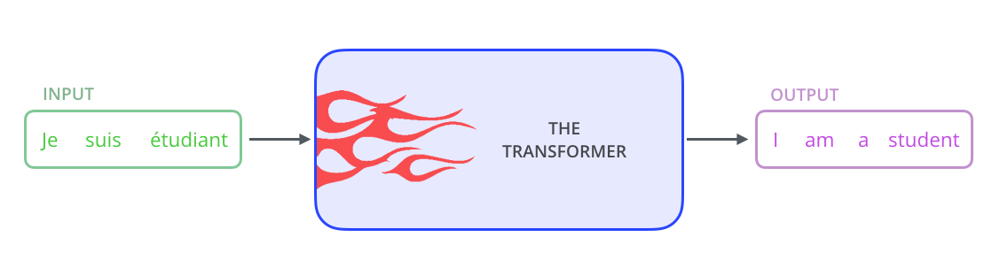

> Popping open that Optimus Prime goodness, we see an encoding component, a decoding component, and connections between them.

> 打开这个"擎天柱"（呼应 Transformer 变形金刚梗），我们看到一个 encoding 组件、一个 decoding 组件，以及两者之间的连接。

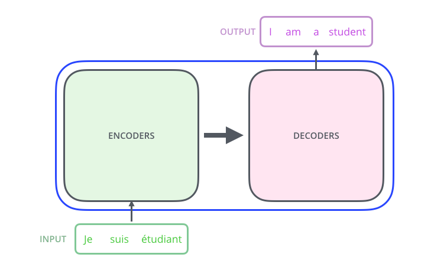

> The encoding component is a stack of encoders (the paper stacks six of them on top of each other – there's nothing magical about the number six, one can definitely experiment with other arrangements). The decoding component is a stack of decoders of the same number.

> Encoding 组件是一摞 encoder（论文叠了 6 个——6 这个数字没有魔法，完全可以实验其他层数）；decoding 组件是同样数量的一摞 decoder。

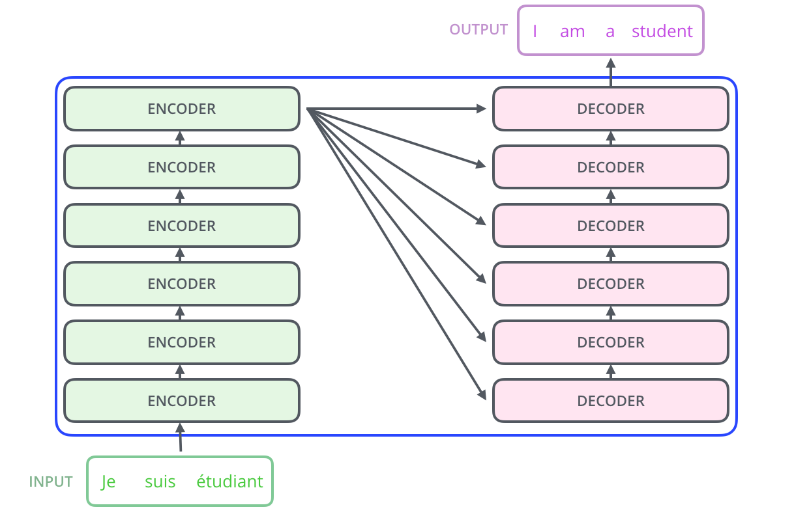

> The encoders are all identical in structure (yet they do not share weights). Each one is broken down into two sub-layers:

> 各 encoder 结构完全相同（但不共享权重），每个拆成两个 sub-layer：

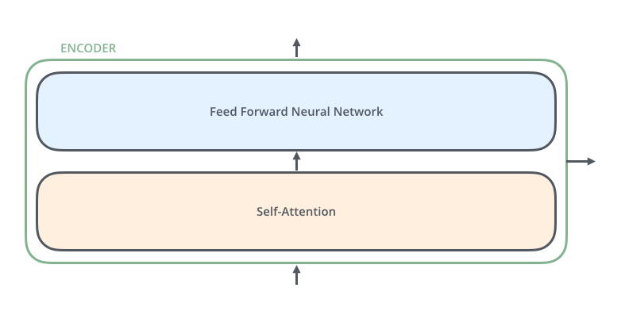

> The encoder's inputs first flow through a self-attention layer – a layer that helps the encoder look at other words in the input sentence as it encodes a specific word. We'll look closer at self-attention later in the post.

> Encoder 的输入先流经 self-attention 层——在编码某个词时，帮助它"看"输入句子里的其他词。后文细讲 self-attention。

> The outputs of the self-attention layer are fed to a feed-forward neural network. The exact same feed-forward network is independently applied to each position.

> Self-attention 层的输出送入一个 feed-forward neural network，同一个网络独立地应用到每个位置。

> The decoder has both those layers, but between them is an attention layer that helps the decoder focus on relevant parts of the input sentence (similar what attention does in seq2seq models).

> Decoder 也包含这两层，但中间多了一个 attention 层，帮 decoder 聚焦输入句子的相关部分（类似 seq2seq 模型里 attention 的作用）。

### Bringing The Tensors Into The Picture（引入张量）

> Now that we've seen the major components of the model, let's start to look at the various vectors/tensors and how they flow between these components to turn the input of a trained model into an output.

> 看完了主要组件，下面看各种向量/张量如何在组件之间流动，把训练好模型的输入变成输出。

> As is the case in NLP applications in general, we begin by turning each input word into a vector using an embedding algorithm.

> 和 NLP 应用一样，先用 embedding 算法把每个输入词变成向量。

> The embedding only happens in the bottom-most encoder. The abstraction that is common to all the encoders is that they receive a list of vectors each of the size 512 – In the bottom encoder that would be the word embeddings, but in other encoders, it would be the output of the encoder that's directly below. The size of this list is hyperparameter we can set – basically it would be the length of the longest sentence in our training dataset.

> Embedding 只在最底层 encoder 发生。所有 encoder 的共同抽象是：接收一列 512 维向量——最底层是词 embedding，其他层是正下方 encoder 的输出。这列向量的长度是可调超参，基本等于训练集中最长句子的长度。

> After embedding the words in our input sequence, each of them flows through each of the two layers of the encoder.

> 输入序列的词完成 embedding 后，每个词流经 encoder 的两个层。

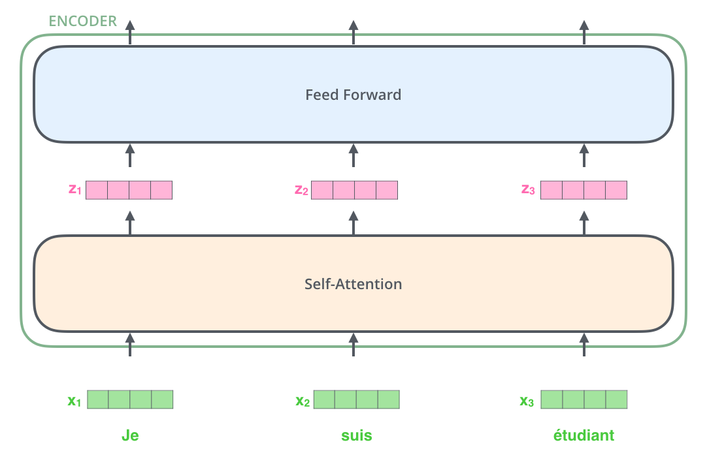

> Here we begin to see one key property of the Transformer, which is that the word in each position flows through its own path in the encoder. There are dependencies between these paths in the self-attention layer. The feed-forward layer does not have those dependencies, however, and thus the various paths can be executed in parallel while flowing through the feed-forward layer.

> 这里开始看到 Transformer 的关键特性：**每个位置的词走自己的路径**。这些路径之间在 self-attention 层有依赖；但 feed-forward 层没有这种依赖，所以各路径流经 feed-forward 层时可以并行执行——这就是并行化的来源。

> Next, we'll switch up the example to a shorter sentence and we'll look at what happens in each sub-layer of the encoder.

> 接下来换个更短的句子，看 encoder 每个 sub-layer 里发生了什么。

### Now We're Encoding!（开始编码）

> As we've mentioned already, an encoder receives a list of vectors as input. It processes this list by passing these vectors into a 'self-attention' layer, then into a feed-forward neural network, then sends out the output upwards to the next encoder.

> 如前所述，encoder 接收一列向量作为输入：先把向量送入 self-attention 层，再送入 feed-forward 网络，然后把输出向上送给下一个 encoder。

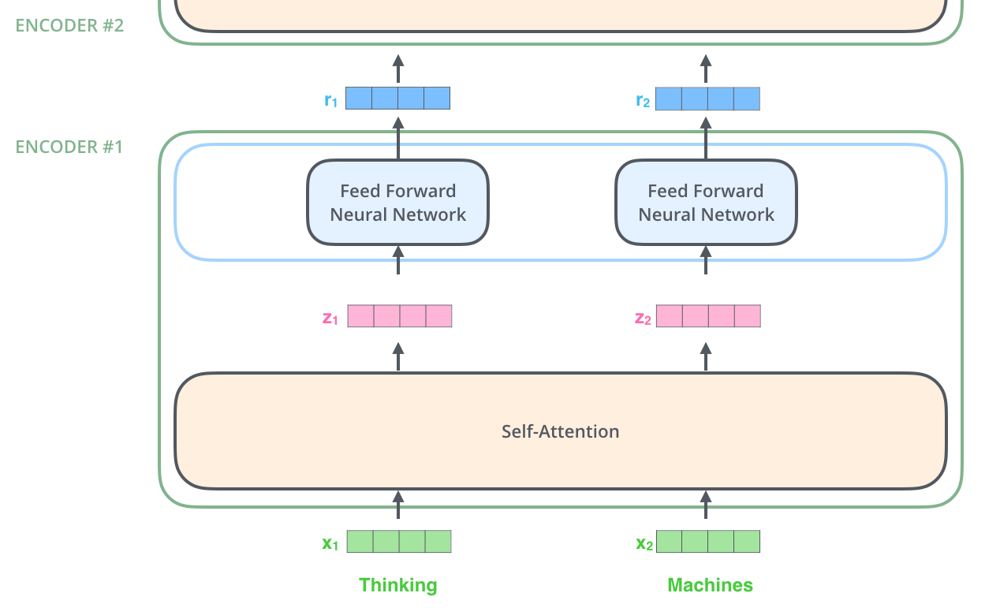

### Self-Attention at a High Level（高层理解 Self-Attention）

> Don't be fooled by me throwing around the word "self-attention" like it's a concept everyone should be familiar with. I had personally never came across the concept until reading the Attention is All You Need paper. Let us distill how it works.

> 别被我随手甩出的 "self-attention" 这个词唬到——作者本人在读《Attention is All You Need》之前也从未接触过这个概念。下面浓缩它的运作方式。

> Say the following sentence is an input sentence we want to translate:
> "The animal didn't cross the street because it was too tired"
> What does "it" in this sentence refer to? Is it referring to the street or to the animal? It's a simple question to a human, but not as simple to an algorithm.

> 假设要翻译这句："The animal didn't cross the street because it was too tired"（那只动物没过马路，因为它太累了）。句中的 "it" 指什么？street 还是 animal？对人类是简单问题，对算法不那么简单。

> When the model is processing the word "it", self-attention allows it to associate "it" with "animal".

> 当模型处理 "it" 时，self-attention 让它把 "it" 与 "animal" 关联起来。

> As the model processes each word (each position in the input sequence), self attention allows it to look at other positions in the input sequence for clues that can help lead to a better encoding for this word.

> 模型处理每个词（输入序列的每个位置）时，self-attention 让它查看其他位置，寻找有助于给当前词生成更好 encoding 的线索。

> If you're familiar with RNNs, think of how maintaining a hidden state allows an RNN to incorporate its representation of previous words/vectors it has processed with the current one it's processing. Self-attention is the method the Transformer uses to bake the "understanding" of other relevant words into the one we're currently processing.

> 熟悉 RNN 的话，想想它如何靠维持 hidden state，把已处理词的表示融入当前正在处理的词。Self-attention 就是 Transformer 用来把"对其他相关词的理解"烘焙进当前词的方法。

> Be sure to check out the Tensor2Tensor notebook where you can load a Transformer model, and examine it using this interactive visualization.

> 作者提醒去 Tensor2Tensor notebook 里加载一个 Transformer 模型，用这个交互式可视化亲手观察。

### Self-Attention in Detail（Self-Attention 细节，向量视角）

> Let's first look at how to calculate self-attention using vectors, the way we'll look at it in the next section, let's proceed to look at how it's actually implemented – using matrices.

> 先看用向量怎么算 self-attention；下一节再讲它的实际实现方式——用矩阵。

> The first step in calculating self-attention is to create three vectors from each of the encoder's input vectors (in this case, the embedding of each word). So for each word, we create a Query vector, a Key vector, and a Value vector. These vectors are created by multiplying the embedding by three matrices that we trained during the training process.

> 第一步：从 encoder 的每个输入向量（这里是每个词的 embedding）各造出三个向量——Query 向量、Key 向量、Value 向量。方法是把 embedding 分别乘以三个训练好的权重矩阵。

> Notice that these new vectors are smaller in dimension than the embedding vector. Their dimensionality is 64, while the embedding and encoder input/output vectors have dimensionality of 512. They don't HAVE to be smaller, this is an architecture choice to make the computation of multiheaded attention (mostly) constant.

> 注意这些新向量维度比 embedding 小：它们是 64 维，而 embedding 和 encoder 输入/输出向量是 512 维。不一定要更小——这是架构选择，让 multi-headed attention 的计算量（基本）恒定。

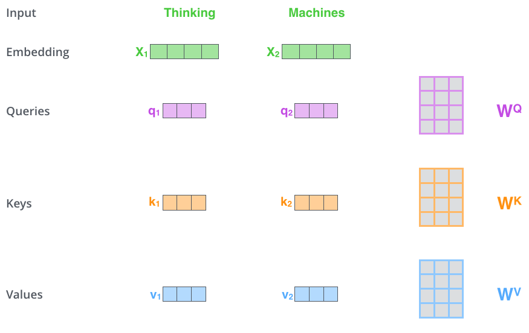

> What are the "query", "key", and "value" vectors? They're abstractions that are useful for calculating and thinking about attention. Once you proceed with reading how attention is calculated below, you'll know pretty much all you need to know about the role each of these vectors plays.

> Q/K/V 是什么？它们是计算和理解 attention 时有用的抽象。读完下面的计算过程，你自然就知道每个向量扮演什么角色。

> The second step in calculating self-attention is to calculate a score. Say we're calculating the self-attention for the first word in this example, "Thinking". We need to score each word of the input sentence against this word. The score determines how much focus to place on other parts of the input sentence as we encode a word at a certain position.

> 第二步：计算 score（分数）。假设算第一个词 "Thinking" 的 self-attention，需要把输入句子里每个词和它打分比较。这个分数决定在编码该位置的词时，要对句子其他部分分配多少注意力。

> The score is calculated by taking the dot product of the query vector with the key vector of the respective word we're scoring. So if we're processing the self-attention for the word in position #1, the first score would be the dot product of q1 and k1. The second score would be the dot product of q1 and k2.

> 分数 = query 向量与被比较词的 key 向量的点积。处理位置 #1 的 self-attention 时，第一个分数是 q1·k1，第二个是 q1·k2，依此类推。

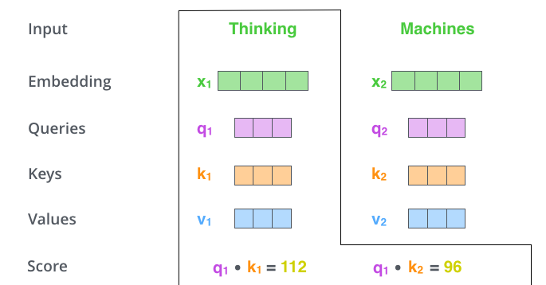

> The third and fourth steps are to divide the scores by 8 (the square root of the dimension of the key vectors used in the paper – 64. This leads to having more stable gradients. There could be other possible values here, but this is the default), then pass the result through a softmax operation. Softmax normalizes the scores so they're all positive and add up to 1.

> 第三、四步：分数除以 8（论文里 key 向量维度 64 的平方根——这样梯度更稳定；也可以取其他值，8 是默认），然后过 softmax。Softmax 把分数归一化为全正且和为 1。

> This softmax score determines how much each word will be expressed at this position. Clearly the word at this position will have the highest softmax score, but sometimes it's useful to attend to another word that is relevant to the current word.

> 这个 softmax 分数决定每个词在当前位置"表达"多少。显然当前位置的词自己分数最高，但有时 attend 到与当前词相关的另一个词很有用。

> The fifth step is to multiply each value vector by the softmax score (in preparation to sum them up). The intuition here is to keep intact the values of the word(s) we want to focus on, and drown-out irrelevant words (by multiplying them by tiny numbers like 0.001, for example).

> 第五步：每个 value 向量乘以其 softmax 分数（为求和做准备）。直觉是：保留想聚焦的词的 value，把不相关的词"淹没"（比如乘以 0.001 这样的小数）。

> The sixth step is to sum up the weighted value vectors. This produces the output of the self-attention layer at this position (for the first word).

> 第六步：把加权后的 value 向量求和，得到该位置 self-attention 层的输出（这里是第一个词）。

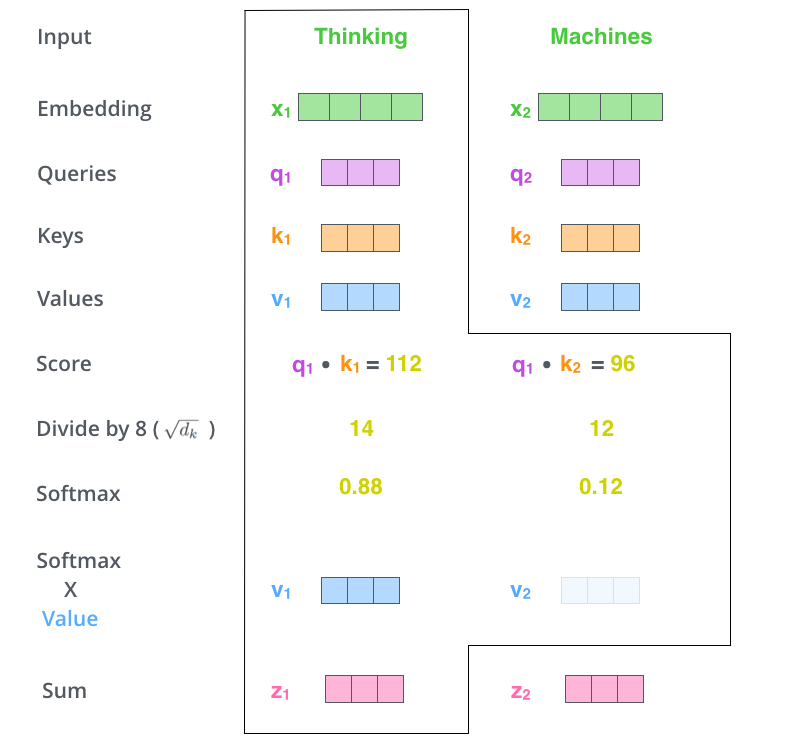

> That concludes the self-attention calculation. The resulting vector is one we can send along to the feed-forward neural network. In the actual implementation, however, this calculation is done in matrix form for faster processing. So let's look at that now that we've seen the intuition of the calculation on the word level.

> Self-attention 计算到此结束，结果向量送往 feed-forward 网络。实际实现中为了更快，用矩阵形式完成这个计算——现在已看懂词级别的直觉，来看看矩阵版。

### Matrix Calculation of Self-Attention（矩阵形式的 Self-Attention）

> The first step is to calculate the Query, Key, and Value matrices. We do that by packing our embeddings into a matrix X, and multiplying it by the weight matrices we've trained (WQ, WK, WV).

> 第一步：计算 Query、Key、Value 矩阵。把 embedding 打包成矩阵 X，分别乘以训练好的权重矩阵 WQ、WK、WV。

> Finally, since we're dealing with matrices, we can condense steps two through six in one formula to calculate the outputs of the self-attention layer.

> 最后，由于是矩阵，可以把第二到六步压缩成一个公式，直接算出 self-attention 层的输出：

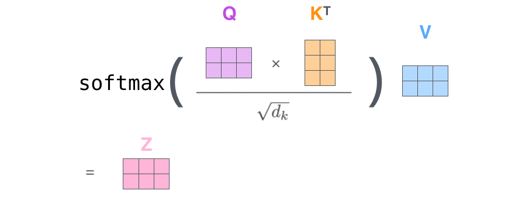

（即论文里的 `Attention(Q,K,V) = softmax(QKᵀ/√d_k)V`——注意与论文 [3.2.1 节](Attention-Is-All-You-Need论文学习.md)完全一致。）

### The Beast With Many Heads（多头怪兽）

> The paper further refined the self-attention layer by adding a mechanism called "multi-headed" attention. This improves the performance of the attention layer in two ways:

> 论文通过加入 "multi-headed" attention 机制进一步改进 self-attention 层，它从两方面提升 attention 层性能：

> It expands the model's ability to focus on different positions. Yes, in the example above, z1 contains a little bit of every other encoding, but it could be dominated by the actual word itself. If we're translating a sentence like "The animal didn't cross the street because it was too tired", it would be useful to know which word "it" refers to.

> ① 扩展模型聚焦不同位置的能力。上例中 z1 虽包含其他编码的一小部分，但可能被词本身主导。翻译 "The animal didn't cross the street because it was too tired" 这类句子时，知道 "it" 指代哪个词很有用。

> It gives the attention layer multiple "representation subspaces". As we'll see next, with multi-headed attention we have not only one, but multiple sets of Query/Key/Value weight matrices (the Transformer uses eight attention heads, so we end up with eight sets for each encoder/decoder). Each of these sets is randomly initialized. Then, after training, each set is used to project the input embeddings (or vectors from lower encoders/decoders) into a different representation subspace.

> ② 给 attention 层多个 "representation subspaces"（表示子空间）。下节可见，multi-headed attention 不是一套而是多套 Q/K/V 权重矩阵（Transformer 用 8 个 attention head，所以每个 encoder/decoder 各有 8 套）。每套随机初始化，训练后各自把输入 embedding（或下层 encoder/decoder 的向量）投影到不同的表示子空间。

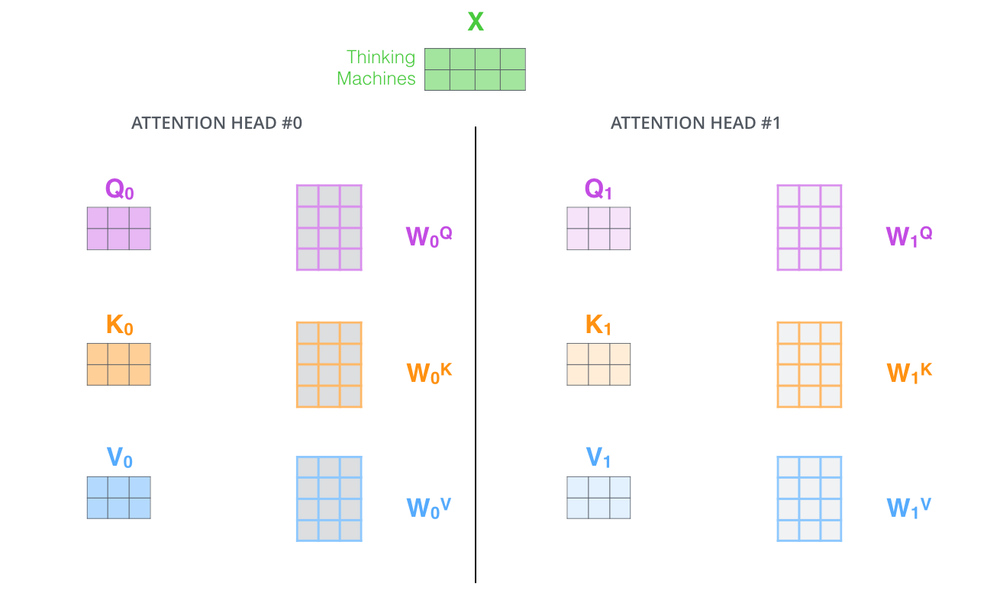

> If we do the same self-attention calculation we outlined above, just eight different times with different weight matrices, we end up with eight different Z matrices.

> 把上面的 self-attention 计算用 8 组不同的权重矩阵各做一遍，得到 8 个不同的 Z 矩阵。

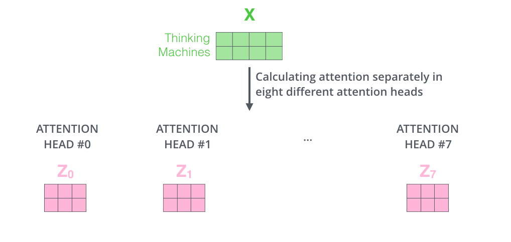

> This leaves us with a bit of a challenge. The feed-forward layer is not expecting eight matrices – it's expecting a single matrix (a vector for each word). So we need a way to condense these eight down into a single matrix.
> How do we do that? We concat the matrices then multiply them by an additional weights matrix WO.

> 这带来一个小挑战：feed-forward 层只期望一个矩阵（每个词一个向量），不是 8 个。解决办法：把 8 个矩阵 concat 起来，再乘一个额外权重矩阵 WO。

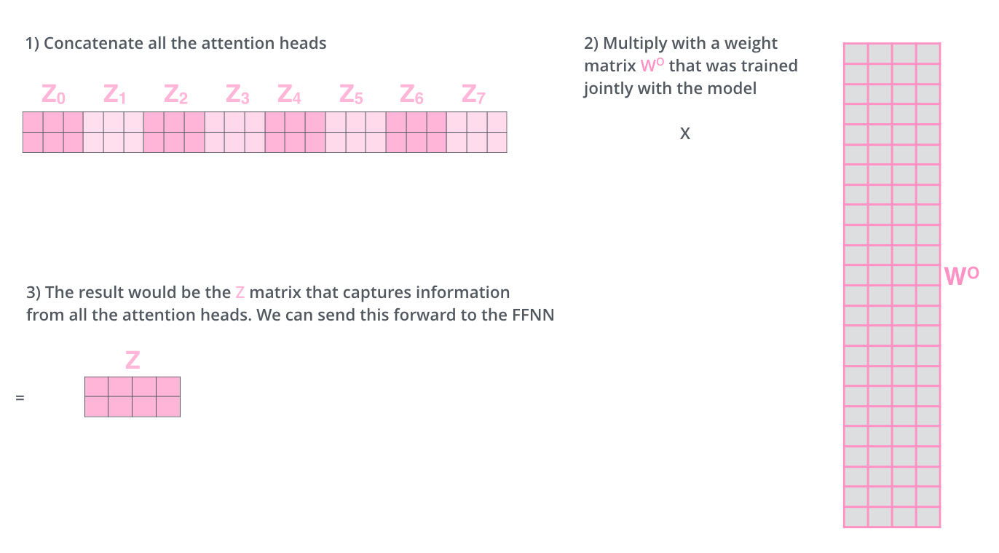

> That's pretty much all there is to multi-headed self-attention. It's quite a handful of matrices, I realize. Let me try to put them all in one visual so we can look at them in one place.

> Multi-headed self-attention 基本就这些了。矩阵确实不少，作者把它们放进一张图里总览：

> Now that we have touched upon attention heads, let's revisit our example from before to see where the different attention heads are focusing as we encode the word "it" in our example sentence:

> 回到之前的例子，看看编码 "it" 时各个 attention head 分别聚焦在哪里：

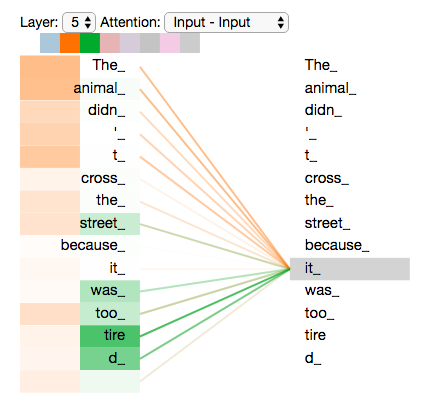

> If we add all the attention heads to the picture, however, things can be harder to interpret:

> 如果把所有 attention head 都画上，画面会更难解读（但能看出不同 head 学到了不同的注意力模式）：

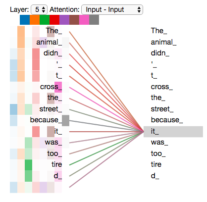

### Representing The Order of The Sequence Using Positional Encoding（用位置编码表示顺序）

> One thing that's missing from the model as we have described it so far is a way to account for the order of the words in the input sequence.

> 目前描述的模型缺一样东西：表示输入序列中词的**顺序**。

> To address this, the transformer adds a vector to each input embedding. These vectors follow a specific pattern that the model learns, which helps it determine the position of each word, or the distance between different words in the sequence. The intuition here is that adding these values to the embeddings provides meaningful distances between the embedding vectors once they're projected into Q/K/V vectors and during dot-product attention.

> 为此 Transformer 给每个输入 embedding 加一个向量。这些向量遵循特定模式，帮助模型判断每个词的位置或不同词之间的距离。直觉是：把这些值加到 embedding 上，当它们被投影成 Q/K/V 向量并做点积 attention 时，向量之间就有了有意义的"距离"。

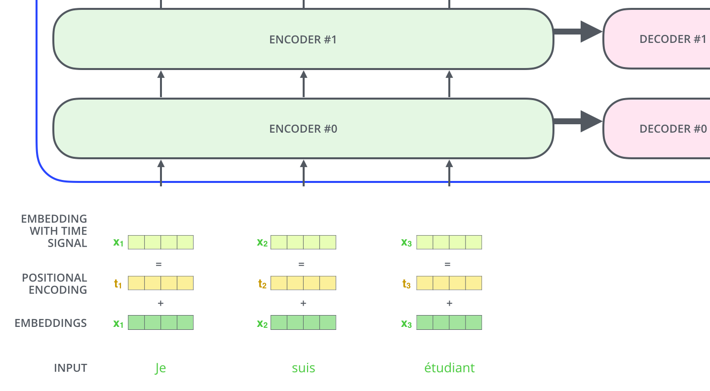

> If we assumed the embedding has a dimensionality of 4, the actual positional encodings would look like this:

> 假设 embedding 维度是 4，位置编码看起来像这样：

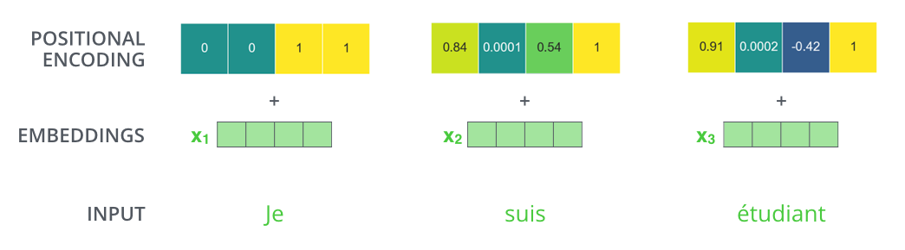

> What might this pattern look like?
> In the following figure, each row corresponds to a positional encoding of a vector. So the first row would be the vector we'd add to the embedding of the first word in an input sequence. Each row contains 512 values – each with a value between 1 and -1. We've color-coded them so the pattern is visible.

> 这个模式长什么样？下图中每行是一个位置编码向量：第一行加在输入序列第一个词的 embedding 上。每行 512 个值，范围 -1 到 1，用颜色区分以便看出模式。

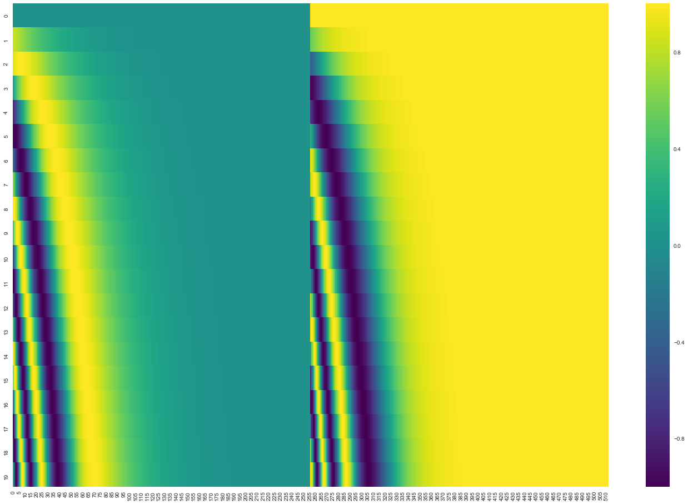

> The formula for positional encoding is described in the paper (section 3.5). You can see the code for generating positional encodings in get_timing_signal_1d(). This is not the only possible method for positional encoding. It, however, gives the advantage of being able to scale to unseen lengths of sequences (e.g. if our trained model is asked to translate a sentence longer than any of those in our training set).

> 位置编码公式见论文 3.5 节，生成代码见 Tensor2Tensor 的 `get_timing_signal_1d()`。位置编码不止这一种方法，但它的优势是**能扩展到训练时没见过的序列长度**（比如让训练好的模型翻译比训练集任何句子都长的句子）。

> July 2020 Update: The positional encoding shown above is from the Tensor2Tensor implementation of the Transformer. The method shown in the paper is slightly different in that it doesn't directly concatenate, but interweaves the two signals. The following figure shows what that looks like.

> 2020 年 7 月更新：上面展示的是 Tensor2Tensor 实现的位置编码；论文里的方法略有不同——不是直接拼接两个信号，而是交错（interweave）排列，下图所示：

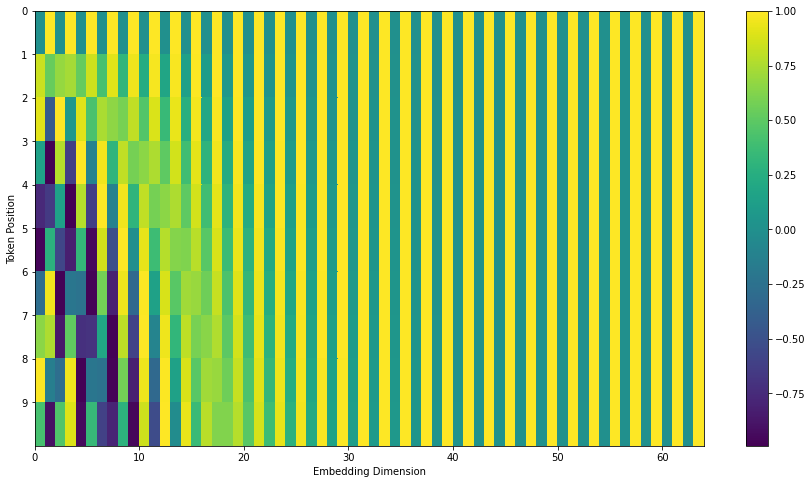

### The Residuals（残差连接）

> One detail in the architecture of the encoder that we need to mention before moving on, is that each sub-layer (self-attention, ffnn) in each encoder has a residual connection around it, and is followed by a layer-normalization step.

> 继续之前要提到 encoder 架构的一个细节：每个 encoder 的每个 sub-layer（self-attention、ffnn）外面都有一圈 residual connection，后面接 layer-normalization。

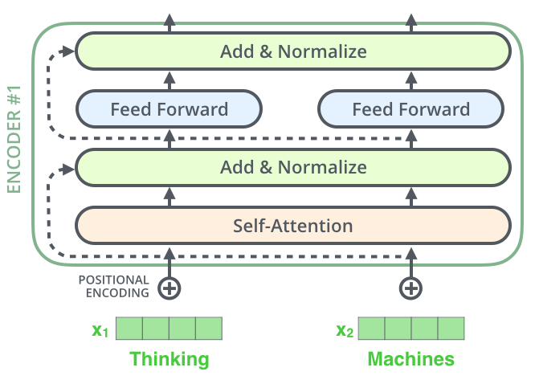

> If we're to visualize the vectors and the layer-norm operation associated with self attention, it would look like this:

> 把向量和 self-attention 相关的 layer-norm 操作画出来，像这样：

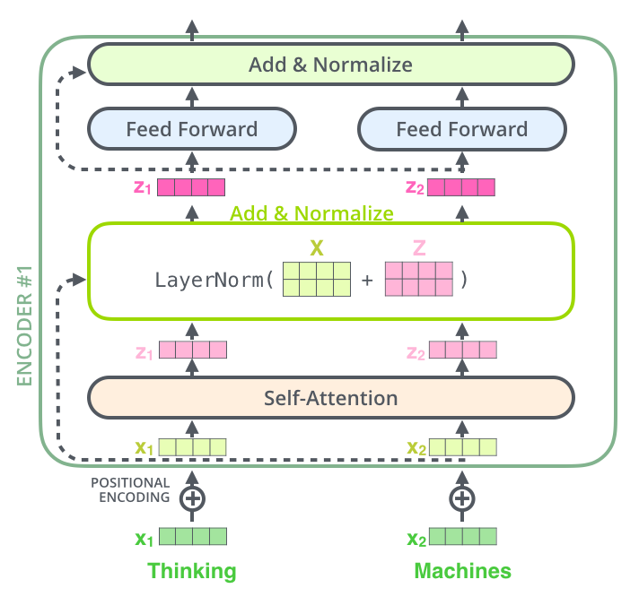

> This goes for the sub-layers of the decoder as well. If we're to think of a Transformer of 2 stacked encoders and decoders, it would look something like this:

> Decoder 的 sub-layer 同样如此。想象一个只有 2 层 encoder+decoder 的 Transformer，整体长这样：

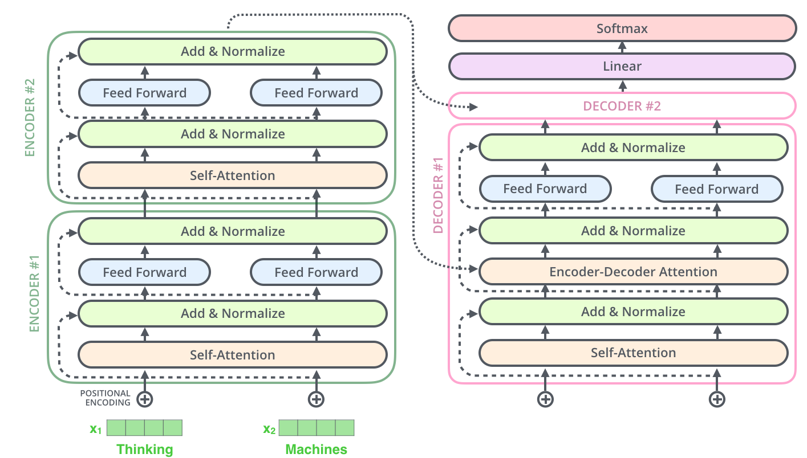

### The Decoder Side（Decoder 侧）

> Now that we've covered most of the concepts on the encoder side, we basically know how the components of decoders work as well. But let's take a look at how they work together.

> Encoder 侧的主要概念讲完，decoder 各组件怎么工作我们基本已懂。下面看它们如何协同。

> The encoder start by processing the input sequence. The output of the top encoder is then transformed into a set of attention vectors K and V. These are to be used by each decoder in its "encoder-decoder attention" layer which helps the decoder focus on appropriate places in the input sequence:

> Encoder 先处理输入序列，最顶层 encoder 的输出被变换成一组 attention 向量 K 和 V，供每个 decoder 的 "encoder-decoder attention" 层使用，帮 decoder 聚焦输入序列的恰当位置：

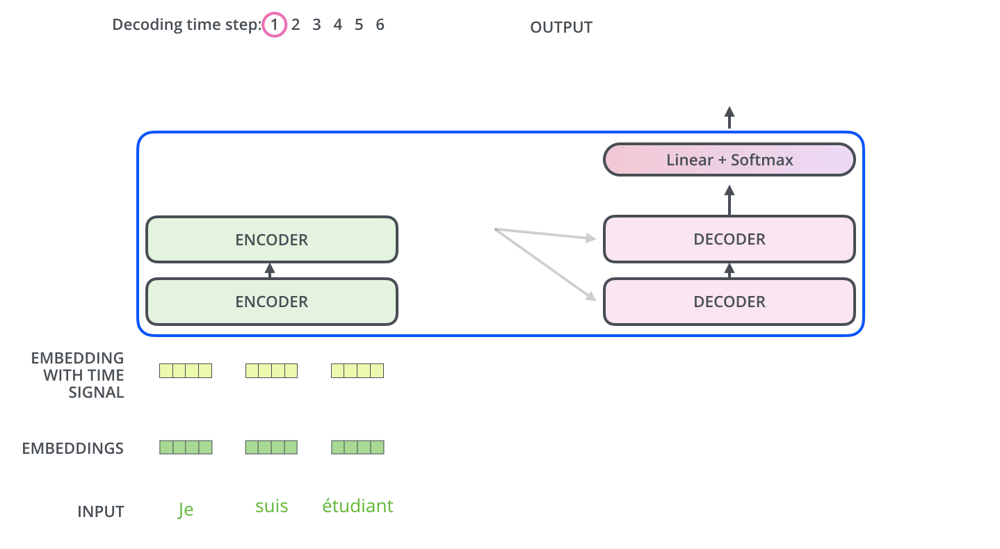

> The following steps repeat the process until a special symbol is reached indicating the transformer decoder has completed its output. The output of each step is fed to the bottom decoder in the next time step, and the decoders bubble up their decoding results just like the encoders did. And just like we did with the encoder inputs, we embed and add positional encoding to those decoder inputs to indicate the position of each word.

> 以下步骤循环重复，直到产生一个特殊符号（表示 decoder 已完成输出）。每一步的输出在下一个时间步送入底层 decoder，decoders 也像 encoders 一样把解码结果层层"冒泡"上去。和 encoder 输入一样，decoder 输入也要做 embedding 并加位置编码，标记每个词的位置。

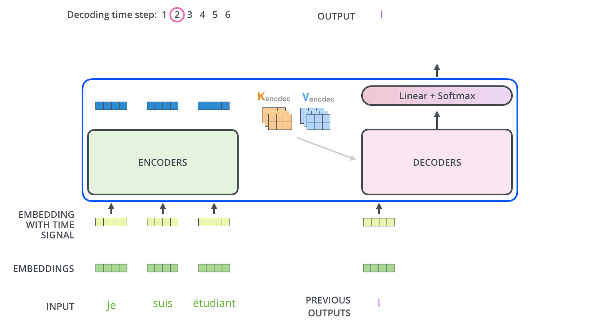

> The self attention layers in the decoder operate in a slightly different way than the one in the encoder:
> In the decoder, the self-attention layer is only allowed to attend to earlier positions in the output sequence. This is done by masking future positions (setting them to -inf) before the softmax step in the self-attention calculation.

> Decoder 里的 self-attention 层和 encoder 略有不同：decoder 的 self-attention **只允许 attend 输出序列中更早的位置**，做法是在 softmax 之前把未来位置 mask 掉（置为 -inf）。

> The "Encoder-Decoder Attention" layer works just like multiheaded self-attention, except it creates its Queries matrix from the layer below it, and takes the Keys and Values matrix from the output of the encoder stack.

> "Encoder-Decoder Attention" 层工作方式与 multiheaded self-attention 相同，只是 Queries 矩阵来自它下面的层，而 Keys 和 Values 矩阵来自 encoder stack 的输出。

### The Final Linear and Softmax Layer（最后的 Linear 与 Softmax 层）

> The decoder stack outputs a vector of floats. How do we turn that into a word? That's the job of the final Linear layer which is followed by a Softmax Layer.

> Decoder stack 输出一个浮点向量。怎么变成词？这是最后 Linear 层 + Softmax 层的工作。

> The Linear layer is a simple fully connected neural network that projects the vector produced by the stack of decoders, into a much, much larger vector called a logits vector.

> Linear 层是一个简单的全连接网络，把 decoder stack 产生的向量投影成一个大得多的向量——叫 **logits vector**。（呼应 [Logits 到底是什么](../SystemOne/2026-10-02%20Logits到底是什么.md)：这就是模型"下一跳直觉"的原始分数向量。）

> Let's assume that our model knows 10,000 unique English words (our model's "output vocabulary") that it's learned from its training dataset. This would make the logits vector 10,000 cells wide – each cell corresponding to the score of a unique word. That is how we interpret the output of the model followed by the Linear layer.

> 假设模型从训练集学会了 10,000 个不重复的英文词（"output vocabulary"），那 logits 向量就是 10,000 格宽——每格对应一个词的分值。这就是我们解读 Linear 层输出的方式。

> The softmax layer then turns those scores into probabilities (all positive, all add up to 1.0). The cell with the highest probability is chosen, and the word associated with it is produced as the output for this time step.

> Softmax 层把这些分数变成概率（全正、和为 1.0），选概率最高的格，对应的词就是这个时间步的输出。

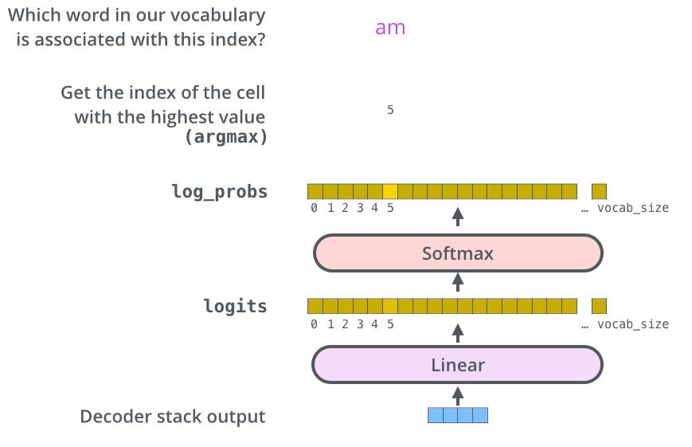

### Recap Of Training（训练回顾）

> Now that we've covered the entire forward-pass process through a trained Transformer, it would be useful to glance at the intuition of training the model.

> 已走完训练好模型的完整 forward-pass，现在补一眼训练时的直觉。

> During training, an untrained model would go through the exact same forward pass. But since we are training it on a labeled training dataset, we can compare its output with the actual correct output.

> 训练时，未训练的模型走完全相同的 forward-pass；因为用的是带标签的训练集，可以拿它的输出和真实正确答案比较。

> To visualize this, let's assume our output vocabulary only contains six words ("a", "am", "i", "thanks", "student", and "<eos>" (short for 'end of sentence')).

> 为了可视化，假设 output vocabulary 只有 6 个词："a"、"am"、"i"、"thanks"、"student" 和 "<eos>"（'end of sentence' 的缩写）。

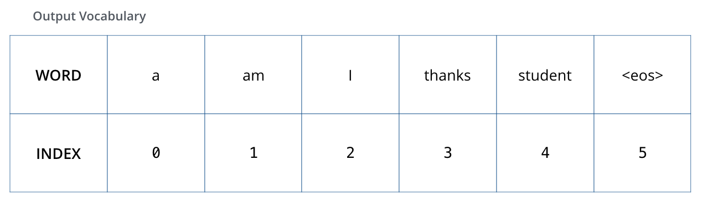

> Once we define our output vocabulary, we can use a vector of the same width to indicate each word in our vocabulary. This also known as one-hot encoding. So for example, we can indicate the word "am" using the following vector:

> 定义了 output vocabulary 后，可以用一个同宽向量表示词表中的每个词——这就是 one-hot encoding。比如 "am" 用下面这个向量表示：

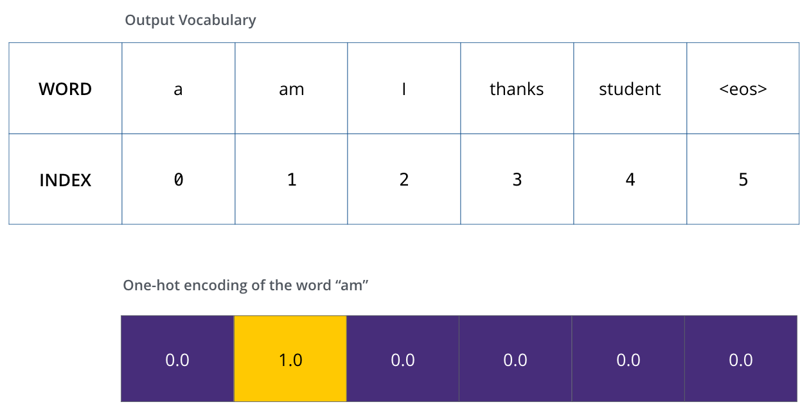

> Following this recap, let's discuss the model's loss function – the metric we are optimizing during the training phase to lead up to a trained and hopefully amazingly accurate model.

> 回顾完训练，讨论 loss function——训练阶段持续优化的指标，优化它才能得到一个训练好、精度惊人的模型。

### The Loss Function（Loss 函数）

> Say we are training our model. Say it's our first step in the training phase, and we're training it on a simple example – translating "merci" into "thanks".
> What this means, is that we want the output to be a probability distribution indicating the word "thanks". But since this model is not yet trained, that's unlikely to happen just yet.

> 假设正在训练第一步，用简单例子——把 "merci" 翻成 "thanks"。意思是希望输出是一个指向 "thanks" 的概率分布，但模型还没训练，暂时不太可能。

> How do you compare two probability distributions? We simply subtract one from the other. For more details, look at cross-entropy and Kullback–Leibler divergence.

> 怎么比较两个概率分布？简单说就是把一个从另一个里减。细节可看 cross-entropy 和 Kullback–Leibler divergence。

> But note that this is an oversimplified example. More realistically, we'll use a sentence longer than one word. For example – input: "je suis étudiant" and expected output: "i am a student". What this really means, is that we want our model to successively output probability distributions where:

> 注意这是过度简化的例子。更现实的是用多词句子，如输入 "je suis étudiant"、期望输出 "i am a student"。真正含义是：希望模型依次输出一串概率分布，使得……（图中标注了每一步的目标词）：

> After training the model for enough time on a large enough dataset, we would hope the produced probability distributions would look like this:

> 在足够大的数据集上训练足够久之后，希望产生的概率分布像这样（"i"、"am"、"a"、"student"、"<eos>" 各自占据高概率）：

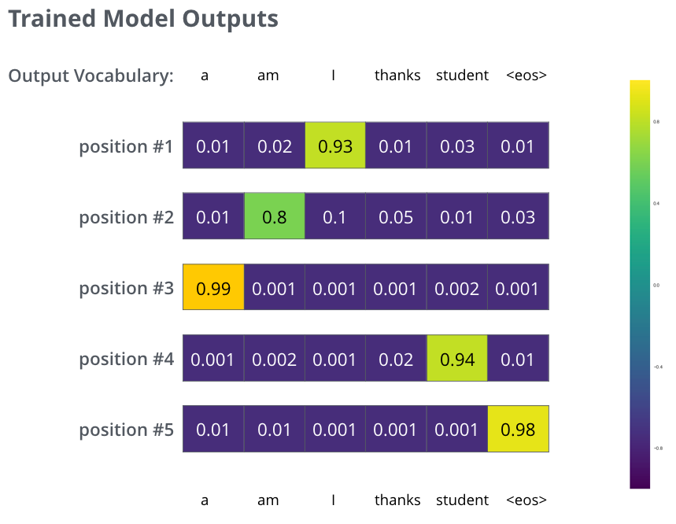

> Now, because the model produces the outputs one at a time, we can assume that the model is selecting the word with the highest probability from that probability distribution and throwing away the rest. That's one way to do it (called greedy decoding). Another way to do it would be to hold on to, say, the top two words (say, 'I' and 'a' for example), then in the next step, run the model twice: once assuming the first output position was the word 'I', and another time assuming the first output position was the word 'a', and whichever version produced less error considering both positions #1 and #2 is kept. We repeat this for positions #2 and #3…etc. This method is called "beam search", where in our example, beam_size was two (meaning that at all times, two partial hypotheses (unfinished translations) are kept in memory), and top_beams is also two (meaning we'll return two translations). These are both hyperparameters that you can experiment with.

> 因为模型逐个词输出，一种做法是每步只选概率最高的词、丢弃其余——这叫 **greedy decoding**。另一种是保留比如前两个词（如 'I' 和 'a'），下一步跑两遍模型：一遍假设第一个输出位置是 'I'，另一遍假设是 'a'，综合考虑位置 #1 和 #2 哪个版本误差小就保留哪个；对位置 #2、#3 依次重复。这个方法叫 **beam search**：本例中 beam_size 为 2（任何时刻内存里保持 2 个部分假设/未完成译文），top_beams 也是 2（返回 2 个译文）。两者都是可调实验的超参。

### Go Forth And Transform（去传播 Transformer 吧）

> I hope you've found this a useful place to start to break the ice with the major concepts of the Transformer. If you want to go deeper, I'd suggest these next steps:

> 希望这篇文章是你深入 Transformer 各大概念的一个有用起点。想更深入，作者建议这些后续方向（原文为链接列表：The Illustrated Attention、The Illustrated GAN、The Illustrated Word2Vec 等系列图解文章，以及 Transformer 相关课程与论文）。

---

## 阅读笔记（待补充）

- [ ] 本文向量级 Q/K/V 六步流程（打分→÷8→softmax→加权→求和）与论文矩阵公式一一对应，可作为给非技术同事讲 Transformer 的脚本
- [ ] 用本地 vLLM + Qwen 跑 `logprobs`，把"The Final Linear and Softmax Layer"一节里的 logits 概念落到实测
- [ ] 2025 更新提到的免费动画短课值得找来配合本文看图
